# Diagramas de Casos de Uso — SIMOA (Sistema IoT de Monitoreo Ambiental)

Documento consolidado que reúne exclusivamente el **Diagrama de Casos de Uso General**, los **13 Diagramas de Casos de Uso Específicos (`CU-01` a `CU-13`)** correspondientes 1:1 a las historias de usuario (`HU-01` a `HU-13`) y la **Tabla de Trazabilidad** del sistema **SIMOA**.

---

## 1. Diagrama de Casos de Uso General

El siguiente diagrama UML representa de manera general las funcionalidades del sistema **SIMOA**, los límites del sistema y la interacción de todos los actores (**Usuario (Operador)**, **Administrador**, **Técnico de Mantenimiento**, **Supervisor** y **Dispositivo IoT (ESP32)**), sirviendo como referencia base para los diagramas individuales:

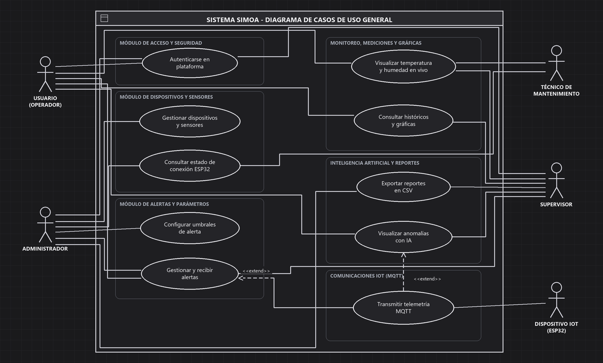

---

## 2. Diagramas de Casos de Uso Específicos por Historia de Usuario (`CU-01` a `CU-13`)

A continuación se presenta un diagrama UML individual por cada una de las 13 historias de usuario (`HU-01` a `HU-13`), manteniendo correspondencia directa con el diagrama general:

### CU-01: Iniciar sesión en plataforma (HU-01)
- **Código del caso de uso:** `CU-01`
- **Nombre del caso de uso:** Iniciar sesión en plataforma
- **Historia de usuario relacionada:** `HU-01`
- **Actor(es):** Administrador / Usuario (Operador) / Técnico de Mantenimiento / Supervisor
- **Caso de uso general relacionado:** CUG-01: Autenticarse en plataforma

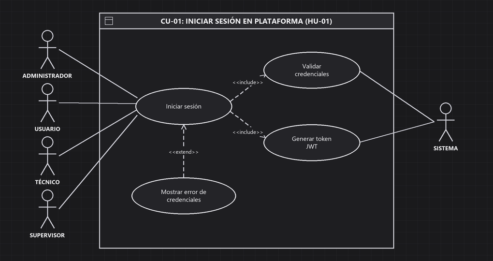

---

### CU-02: Registrar dispositivo IoT (HU-02)
- **Código del caso de uso:** `CU-02`
- **Nombre del caso de uso:** Registrar dispositivo IoT
- **Historia de usuario relacionada:** `HU-02`
- **Actor(es):** Administrador
- **Caso de uso general relacionado:** CUG-05: Gestionar dispositivos y sensores

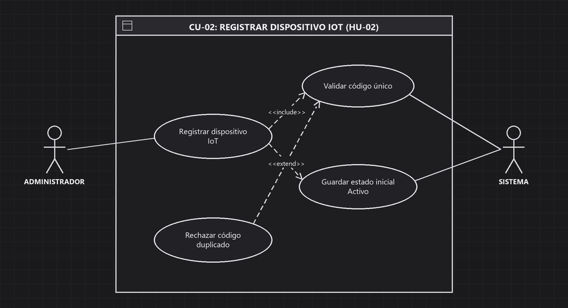

---

### CU-03: Asignar ubicación física a dispositivos (HU-03)
- **Código del caso de uso:** `CU-03`
- **Nombre del caso de uso:** Asignar ubicación física a dispositivos
- **Historia de usuario relacionada:** `HU-03`
- **Actor(es):** Administrador
- **Caso de uso general relacionado:** CUG-05: Gestionar dispositivos y sensores

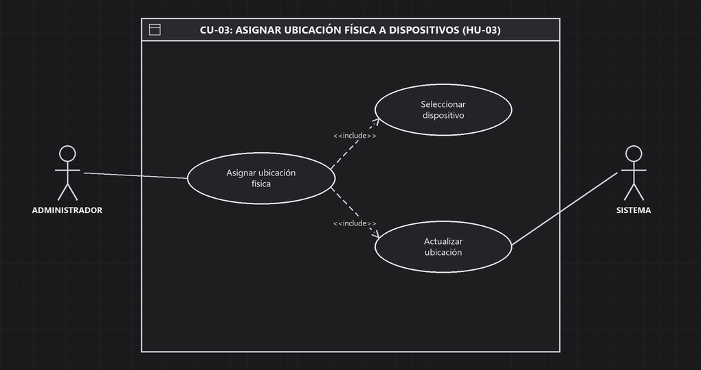

---

### CU-04: Asociar sensores DHT22 a dispositivos (HU-04)
- **Código del caso de uso:** `CU-04`
- **Nombre del caso de uso:** Asociar sensores DHT22 a dispositivos
- **Historia de usuario relacionada:** `HU-04`
- **Actor(es):** Administrador
- **Caso de uso general relacionado:** CUG-05: Gestionar dispositivos y sensores

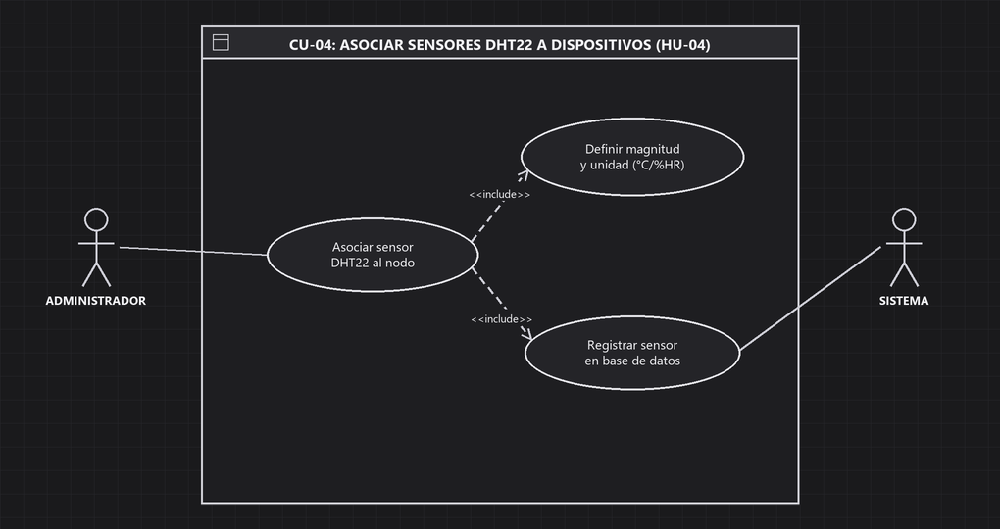

---

### CU-05: Visualizar temperatura actual en tiempo real (HU-05)
- **Código del caso de uso:** `CU-05`
- **Nombre del caso de uso:** Visualizar temperatura actual en tiempo real
- **Historia de usuario relacionada:** `HU-05`
- **Actor(es):** Usuario (Operador) / Supervisor
- **Caso de uso general relacionado:** CUG-03: Visualizar temperatura y humedad en vivo

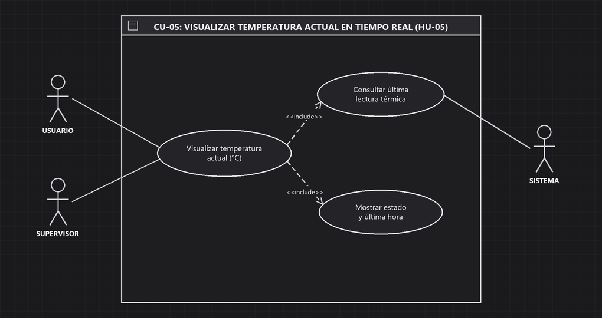

---

### CU-06: Visualizar humedad relativa actual en tiempo real (HU-06)
- **Código del caso de uso:** `CU-06`
- **Nombre del caso de uso:** Visualizar humedad relativa actual en tiempo real
- **Historia de usuario relacionada:** `HU-06`
- **Actor(es):** Usuario (Operador) / Supervisor
- **Caso de uso general relacionado:** CUG-03: Visualizar temperatura y humedad en vivo

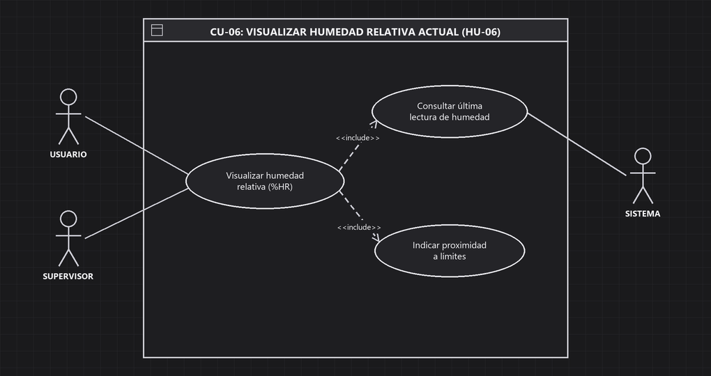

---

### CU-07: Consultar historial de mediciones por rango de fechas (HU-07)
- **Código del caso de uso:** `CU-07`
- **Nombre del caso de uso:** Consultar historial de mediciones por rango de fechas
- **Historia de usuario relacionada:** `HU-07`
- **Actor(es):** Usuario (Operador) / Supervisor
- **Caso de uso general relacionado:** CUG-04: Consultar históricos y gráficas

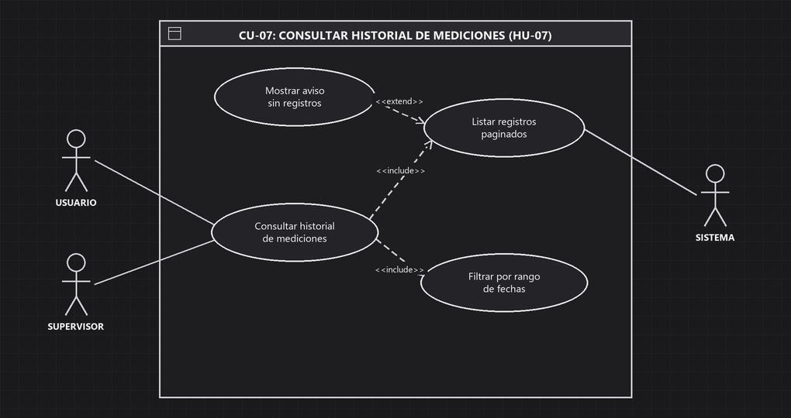

---

### CU-08: Configurar umbrales mínimos y máximos (HU-08)
- **Código del caso de uso:** `CU-08`
- **Nombre del caso de uso:** Configurar umbrales mínimos y máximos
- **Historia de usuario relacionada:** `HU-08`
- **Actor(es):** Administrador
- **Caso de uso general relacionado:** CUG-06: Configurar umbrales de alerta

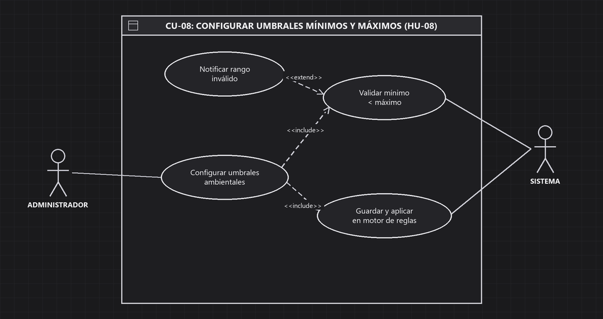

---

### CU-09: Recibir alertas visibles en tiempo real (HU-09)
- **Código del caso de uso:** `CU-09`
- **Nombre del caso de uso:** Recibir alertas visibles en tiempo real
- **Historia de usuario relacionada:** `HU-09`
- **Actor(es):** Usuario (Operador) / Supervisor / Administrador
- **Caso de uso general relacionado:** CUG-07: Gestionar y recibir alertas

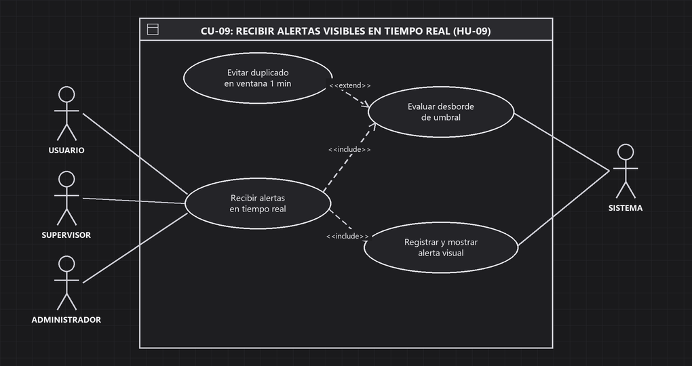

---

### CU-10: Consultar estado de conexión de los nodos ESP32 (HU-10)
- **Código del caso de uso:** `CU-10`
- **Nombre del caso de uso:** Consultar estado de conexión de los nodos ESP32
- **Historia de usuario relacionada:** `HU-10`
- **Actor(es):** Administrador / Técnico de Mantenimiento
- **Caso de uso general relacionado:** CUG-10: Consultar estado de conexión ESP32

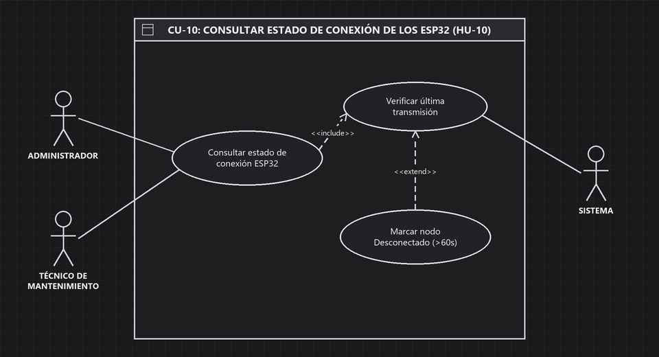

---

### CU-11: Visualizar gráficos de líneas dinámicos (HU-11)
- **Código del caso de uso:** `CU-11`
- **Nombre del caso de uso:** Visualizar gráficos de líneas dinámicos
- **Historia de usuario relacionada:** `HU-11`
- **Actor(es):** Usuario (Operador) / Supervisor
- **Caso de uso general relacionado:** CUG-04: Consultar históricos y gráficas

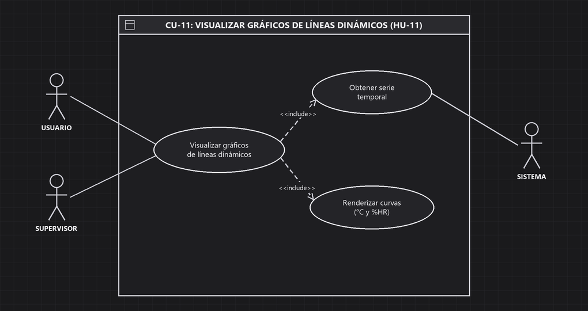

---

### CU-12: Exportar mediciones a archivo CSV (HU-12)
- **Código del caso de uso:** `CU-12`
- **Nombre del caso de uso:** Exportar mediciones a archivo CSV
- **Historia de usuario relacionada:** `HU-12`
- **Actor(es):** Administrador / Supervisor
- **Caso de uso general relacionado:** CUG-09: Exportar reportes en CSV

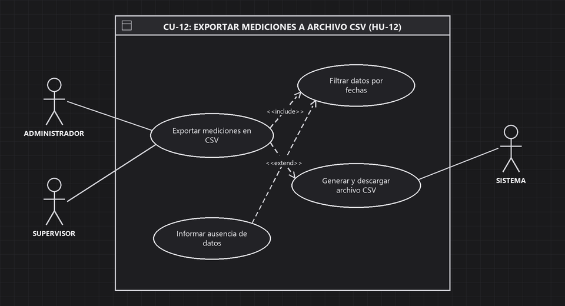

---

### CU-13: Visualizar anomalías detectadas por IA (HU-13)
- **Código del caso de uso:** `CU-13`
- **Nombre del caso de uso:** Visualizar anomalías detectadas por IA
- **Historia de usuario relacionada:** `HU-13`
- **Actor(es):** Usuario (Operador) / Supervisor / Administrador
- **Caso de uso general relacionado:** CUG-08: Visualizar anomalías con IA

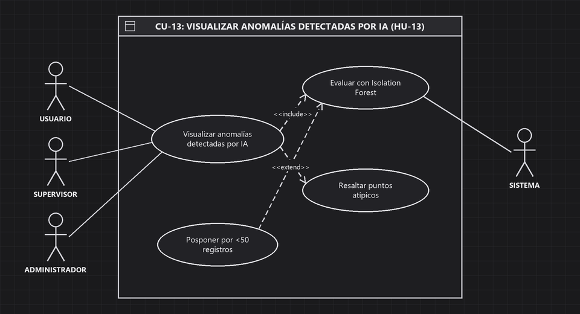

---

## 3. Tabla de Trazabilidad (Historias de Usuario, Actores y Casos de Uso)

| Historia de usuario | Actor | Caso de uso | Caso de uso general relacionado |
| :--- | :--- | :--- | :--- |
| **HU-01:** Iniciar sesión con credenciales seguras | Administrador / Usuario / Técnico / Supervisor | **CU-01:** Iniciar sesión en plataforma | Autenticarse en plataforma |
| **HU-02:** Registrar dispositivos IoT | Administrador | **CU-02:** Registrar dispositivo IoT | Gestionar dispositivos y sensores |
| **HU-03:** Asignar ubicación física a dispositivos | Administrador | **CU-03:** Asignar ubicación física a dispositivos | Gestionar dispositivos y sensores |
| **HU-04:** Asociar sensores DHT22 a cada nodo | Administrador | **CU-04:** Asociar sensores DHT22 a dispositivos | Gestionar dispositivos y sensores |
| **HU-05:** Visualizar temperatura actual en tiempo real | Usuario (Operador) / Supervisor | **CU-05:** Visualizar temperatura actual en tiempo real | Visualizar temperatura y humedad en vivo |
| **HU-06:** Visualizar humedad relativa actual | Usuario (Operador) / Supervisor | **CU-06:** Visualizar humedad relativa actual en tiempo real | Visualizar temperatura y humedad en vivo |
| **HU-07:** Consultar historial de mediciones por rango de fechas | Usuario (Operador) / Supervisor | **CU-07:** Consultar historial de mediciones por rango de fechas | Consultar históricos y gráficas |
| **HU-08:** Configurar umbrales mínimos y máximos | Administrador | **CU-08:** Configurar umbrales mínimos y máximos | Configurar umbrales de alerta |
| **HU-09:** Recibir alertas visibles en tiempo real | Usuario (Operador) / Supervisor / Administrador | **CU-09:** Recibir alertas visibles en tiempo real | Gestionar y recibir alertas |
| **HU-10:** Consultar estado de conexión de los nodos ESP32 | Administrador / Técnico de Mantenimiento | **CU-10:** Consultar estado de conexión de los nodos ESP32 | Consultar estado de conexión ESP32 |
| **HU-11:** Visualizar gráficos de líneas dinámicos | Usuario (Operador) / Supervisor | **CU-11:** Visualizar gráficos de líneas dinámicos | Consultar históricos y gráficas |
| **HU-12:** Exportar mediciones a archivo CSV | Administrador / Supervisor | **CU-12:** Exportar mediciones a archivo CSV | Exportar reportes en CSV |
| **HU-13:** Visualizar anomalías detectadas por IA | Usuario (Operador) / Supervisor / Administrador | **CU-13:** Visualizar anomalías detectadas por IA | Visualizar anomalías con IA |
