# SERVICIO NACIONAL DE APRENDIZAJE – SENA
## CENTRO DE LA INDUSTRIA, LA EMPRESA Y LOS SERVICIOS (CIES)
### REGIONAL HUILA – NEIVA, HUILA
### PROGRAMA: TECNÓLOGO EN ANÁLISIS Y DESARROLLO DE SOFTWARE (ADSO)
**FICHA:** 3413988  
**AÑO:** 2026  

---

# ESPECIFICACIÓN DE REQUISITOS DE SOFTWARE (SRS)
## SISTEMA IOT DE MONITOREO AMBIENTAL (SIMOA)

```
        ███████╗██╗███╗   ███╗ ██████╗  █████╗ 
        ██╔════╝██║████╗ ████║██╔═══██╗██╔══██╗
        ███████╗██║██╔████╔██║██║   ██║███████║
        ╚════██║██║██║╚██╔╝██║██║   ██║██╔══██║
        ███████║██║██║ ╚═╝ ██║╚██████╔╝██║  ██║
        ╚══════╝╚═╝╚═╝     ╚═╝ ╚═════╝ ╚═╝  ╚═╝
  Sistema IoT de Monitoreo Ambiental con Detección de Anomalías por IA
```

**Presentado por:**  
- Luz Eliana Sánchez Tovar  

**Presentado a:**  
- Instructor: Javier Humberto Pinto  

**Fecha de emisión:** 13/11/2026  
**Versión del documento:** 1.0 (MVP)  

---

## ÍNDICE GENERAL

1. [Introducción](#1-introducción)
   - 1.1 Planteamiento del Problema
   - 1.2 Justificación
   - 1.3 Objetivo General y Objetivos Específicos
   - 1.4 Alcances (Funcionalidades Incluidas y Excluidas)
   - 1.5 Personal Involucrado y Roles
   - 1.6 Definiciones, Acrónimos y Abreviaturas
   - 1.7 Referencias Normativas
   - 1.8 Resumen Ejecutivo
2. [Descripción General](#2-descripción-general)
   - 2.1 Perspectiva del Producto
   - 2.2 Características de los Usuarios
   - 2.3 Restricciones Técnicas y Operativas
   - 2.4 Suposiciones y Dependencias
3. [Requisitos Específicos del Sistema](#3-requisitos-específicos-del-sistema)
   - 3.1 Requisitos Comunes de las Interfaces (UI, Hardware, Software, Comunicaciones)
   - 3.2 Diagramas de Casos de Uso (General, Específicos y Matriz de Coherencia)
   - 3.3 Catálogo y Fichas Detalladas de Requerimientos Funcionales (RF-01 al RF-20)
   - 3.4 Catálogo y Fichas Detalladas de Requerimientos No Funcionales (RNF-01 al RNF-12)
   - 3.5 Historias de Usuario (HU-01 a HU-13) con Criterios de Aceptación
   - 3.6 Reglas de Negocio Consolidadas
   - 3.7 Requisitos del Módulo de Inteligencia Artificial (Isolation Forest)
4. [Arquitectura del Sistema e Integración IoT](#4-arquitectura-del-sistema-e-integración-iot)
   - 4.1 Arquitectura en Capas IoT
   - 4.2 Diagrama de Flujo y Comunicación (Mermaid)
   - 4.3 Especificación de Tópicos MQTT y Payloads JSON
5. [Modelo de Datos y Persistencia](#5-modelo-de-datos-y-persistencia)
   - 5.1 Diagrama Entidad-Relación (Mermaid ER)
   - 5.2 Diccionario de Datos y Reglas de Integridad
6. [Diseño de Servicios y API REST](#6-diseño-de-servicios-y-api-rest)
7. [Diseño y Distribución de Interfaces (UI/UX)](#7-diseño-y-distribución-de-interfaces-uiux)

---

## 1. INTRODUCCIÓN

### 1.1 Planteamiento del Problema
En múltiples recintos cerrados —tales como aulas de formación, laboratorios de cómputo, centros de datos, oficinas, bodegas de almacenamiento y cuartos técnicos— las variables termohigrométricas (temperatura y humedad relativa) sufren fluctuaciones imprevistas debidas a cambios meteorológicos, ocupación humana o fallas en sistemas de climatización. 

En la mayoría de instituciones y organizaciones, el control de estas variables se efectúa de manera manual e intermitente mediante termómetros analógicos o higrómetros aislados. Esta dinámica provoca:
- Falta de supervisión continua y en tiempo real las 24 horas del día.
- Retrasos severos en la identificación de sobrecalentamiento o condensación excesiva que dañan componentes electrónicos, equipos informáticos o materiales higroscópicos.
- Pérdida de trazabilidad histórica, impidiendo auditorías de calidad o cálculos de eficiencia energética.
- Ausencia de mecanismos predictivos o de alerta temprana automatizada que mitiguen daños antes de alcanzar puntos críticos.

### 1.2 Justificación
El desarrollo de **SIMOA (Sistema IoT de Monitoreo Ambiental)** resuelve esta problemática integrando tecnologías de hardware libre, computación en el borde (Edge/IoT), comunicación eficiente basada en eventos (MQTT), procesamiento backend robusto en Python y visualización analítica moderna en React. 

La inclusión de un módulo de Inteligencia Artificial (algoritmo *Isolation Forest*) dota al sistema de capacidad innovadora, permitiendo identificar anomalías silenciosas (microdesviaciones o patrones erráticos que no siempre cruzan los umbrales fijos pero reflejan fallos incipientes en la ventilación o en los sensores). Este desarrollo optimiza la toma de decisiones, salvaguarda el bienestar humano y previene costosas pérdidas de activos críticos.

### 1.3 Objetivos

#### Objetivo General
Desarrollar un sistema IoT de monitoreo ambiental integral que permita registrar, transmitir, almacenar y visualizar mediciones de temperatura y humedad en tiempo real mediante sensores conectados a una plataforma web responsiva, incorporando gestión de alertas automatizadas y detección de anomalías mediante Inteligencia Artificial bajo metodología Scrum en un horizonte de 4 semanas (MVP).

#### Objetivos Específicos
1. **Diseñar la arquitectura IoT** por capas garantizando la interoperabilidad entre nodos de adquisición física, brokers de mensajería, backends y clientes web.
2. **Implementar el dispositivo electrónico de borde** empleando un microcontrolador ESP32 y un sensor digital de precisión DHT22 para el muestreo de temperatura y humedad.
3. **Configurar el protocolo de comunicación MQTT** sobre broker Eclipse Mosquitto con flujos de integración y supervisión en Node-RED.
4. **Desarrollar el backend en Python con FastAPI**, estructurado modularmente para la ingestión asíncrona de datos, autenticación JWT y persistencia en MySQL.
5. **Modelar e implementar la base de datos relacional** con esquemas optimizados para series de tiempo, dispositivos, sensores, alertas y configuraciones de umbrales.
6. **Construir el Dashboard Web en React y Tailwind CSS**, permitiendo al operador y al administrador consultar métricas actuales, gráficos históricos y estados de red.
7. **Integrar un módulo de Inteligencia Artificial (Isolation Forest con Scikit-learn)** para el análisis desatendido y detección de comportamientos anómalos.
8. **Ejecutar el plan de pruebas exhaustivo (unitarias, integración, estrés y hardware)** asegurando la estabilidad y robustez del MVP.

---

### 1.4 Alcances del Proyecto

#### Funcionalidades Incluidas (Alcance MVP)
1. **Gestión de dispositivos IoT:** Registro, identificación mediante código MAC/UUID, asignación de ubicación física y monitoreo de estado de conexión (Heartbeat/Keep-alive).
2. **Gestión de sensores:** Asociación lógica de sensores DHT22 a dispositivos, configuración de magnitudes físicas (°C, %HR) y calibración básica.
3. **Ingestión y telemetría MQTT:** Publicación periódica (cada 5 a 10 segundos) de lecturas empaquetadas en JSON hacia tópicos dedicados.
4. **Persistencia de mediciones:** Almacenamiento indexado con marca temporal precisa (timestamp ISO 8601).
5. **Dashboard ambiental interactivo:** Visualización en vivo (KPIs de temperatura y humedad, tacómetros, gráficos de líneas dinámicos, selector de rango de fechas).
6. **Motor de alertas reactivas:** Detección instantánea de superación de umbrales configurables (mínimos y máximos) con registro de eventos.
7. **Detección de anomalías por Machine Learning:** Módulo en Python que ejecuta periódicamente un modelo *Isolation Forest* para clasificar mediciones atípicas.
8. **Exportación de reportes:** Generación de informes históricos consolidados en formato CSV y PDF.

#### Funcionalidades Excluidas (Fases Futuras)
- Monitoreo de gases tóxicos o contaminantes (CO, CO2, formaldehído, partículas PM2.5).
- Control automatizado por lazo cerrado de actuadores (encendido de aires acondicionados o ventiladores).
- Aplicación móvil nativa en iOS/Android (se cubrirá con diseño web responsivo PWA).
- Geolocalización satelital por GPS o soporte multi-edificio en malla.
- Integración con servicios meteorológicos satelitales externos de terceros.

---

### 1.5 Personal Involucrado y Roles

| Nombre | Rol del Proyecto | Especialidad ADSO | Responsabilidad Técnica |
| :--- | :--- | :--- | :--- |
| **Luz Eliana Sánchez Tovar** | Desarrolladora del Proyecto (Full Stack & IoT) | Aprendiz ADSO | Análisis y especificación de requisitos (SRS), programación de firmware ESP32, desarrollo de backend en FastAPI, base de datos MySQL, módulo de IA y dashboard en React. |

---

### 1.6 Definiciones, Acrónimos y Abreviaturas

| Sigla / Término | Definición Técnica |
| :--- | :--- |
| **SIMOA** | Sistema IoT de Monitoreo Ambiental. |
| **IoT** | *Internet of Things* (Internet de las Cosas). |
| **MVP** | *Minimum Viable Product* (Producto Mínimo Viable). |
| **SRS** | *Software Requirements Specification* (Especificación de Requisitos de Software - IEEE 830). |
| **MQTT** | *Message Queuing Telemetry Transport* (Protocolo ligero de mensajería M2M basado en publicación/suscripción). |
| **Broker** | Servidor intermediario encargado de enrutar mensajes entre clientes MQTT (ej. Eclipse Mosquitto). |
| **ESP32** | SoC (System on a Chip) microcontrolador de 32 bits de Espressif con Wi-Fi y Bluetooth nativos. |
| **DHT22** | Sensor digital de temperatura y humedad con sensor capacitivo y termistor de alta precisión. |
| **Node-RED** | Herramienta de programación visual basada en flujos para conectar dispositivos de hardware y APIs. |
| **FastAPI** | Framework web moderno y de alto rendimiento para construir APIs con Python 3.8+ basado en estándares OpenAPI y tipos tipados. |
| **Isolation Forest** | Algoritmo de aprendizaje no supervisado de Machine Learning diseñado específicamente para detección de anomalías. |
| **JWT** | *JSON Web Token* (Estándar abierto RFC 7519 para transmisión segura de identidad entre partes). |

---

### 1.7 Referencias Normativas
- **IEEE Std 830-1998:** Práctica Recomendada para la Especificación de Requisitos de Software.
- **ISO/IEC/IEEE 29148:2018:** Ingeniería de Sistemas y Software - Procesos del ciclo de vida - Requisitos de ingeniería.
- **OASIS MQTT v3.1.1 / v5.0 Specification.**
- **RFC 7519:** JSON Web Token (JWT).
- **Guía Técnica de Proyectos Formativos SENA - ADSO (2026).**

---

### 1.8 Resumen Ejecutivo
El presente documento describe detalladamente la especificación formal del sistema SIMOA, cubriendo los requerimientos de usuario, funcionales, de interfaz, de seguridad, arquitectónicos y de datos. Este artefacto actúa como la línea base contractual y técnica para el desarrollo del MVP durante el ciclo de vida ágil establecido por el equipo formador del SENA CIES Regional Huila.

---

## 2. DESCRIPCIÓN GENERAL

### 2.1 Perspectiva del Producto
SIMOA es un sistema híbrido ciberfísico autónomo compuesto por tres subsistemas integrados:
1. **Subsistema Físico de Telemetría (Edge):** Hardware ESP32 + DHT22 encargado de capturar lecturas en el ambiente y emitirlas hacia la red de datos vía Wi-Fi.
2. **Subsistema de Ingestión y Reglas (Middleware/Backend):** Broker Mosquitto conectado a canalizadores Node-RED y a la API central desarrollada en Python/FastAPI, con persistencia en MySQL y rutinas en Scikit-learn.
3. **Subsistema de Presentación y Auditoría (Frontend):** Panel de control web Single Page Application (SPA) en React accesible desde cualquier navegador compatible.

### 2.2 Características de los Usuarios

| Perfil de Usuario | Nivel Técnico | Responsabilidades en SIMOA |
| :--- | :--- | :--- |
| **Administrador del Sistema** | Alto | Gestión de cuentas de usuario y asignación de permisos/roles, registro de nuevos nodos ESP32, gestión de dispositivos y sensores, configuración de parámetros del sistema y umbrales críticos de temperatura/humedad, auditoría y parametrización de backups. |
| **Usuario (Operador Ambiental)** | Medio / Básico | Inicio de sesión seguro, monitoreo visual de temperatura y humedad en tiempo real, visualización de gráficas de tendencia, consulta de alertas, historiales y análisis de anomalías, y descarga de reportes. |
| **Técnico de Mantenimiento** | Medio / Alto | Inicio de sesión seguro, consulta del estado operativo de los equipos, verificación de conexiones Wi-Fi/MQTT (en línea/desconectado) y ejecución de las funciones de mantenimiento, calibración y actualización de estado técnico establecidas en el SRS. |
| **Supervisor** | Medio | Inicio de sesión seguro, lectura de paneles de monitoreo ambiental en tiempo real, consulta de históricos, gráficas y anomalías IA, supervisión/gestión del estado de alertas y exportación de reportes consolidados. |

### 2.3 Restricciones Técnicas y Operativas
- **Tiempo de entrega:** 4 semanas estrictas según cronograma Scrum.
- **Conectividad:** Los nodos ESP32 requieren acceso a red Wi-Fi 802.11 b/g/n en banda 2.4 GHz.
- **Broker MQTT:** Debe estar desplegado en el mismo segmento de red local o contar con IP estática / DNS público accesible por los microcontroladores.
- **Consumo de recursos:** El algoritmo de IA debe ejecutarse como tarea en segundo plano (Background Task) para no degradar el tiempo de respuesta del servidor web.

### 2.4 Suposiciones y Dependencias
- Se asume suministro eléctrico estable en las ubicaciones de los nodos sensores vía adaptadores USB 5V 1A.
- Se cuenta con sensores DHT22 calibrados de fábrica con tolerancia de ±0.5 °C en temperatura y ±2% en humedad relativa.

---

## 3. REQUISITOS ESPECÍFICOS DEL SISTEMA

### 3.1 Requisitos Comunes de las Interfaces

#### 3.1.1 Interfaces de Usuario (UI)
- **IU-01:** La aplicación web debe estar basada en un diseño responsivo con Tailwind CSS que se adapte a resoluciones de Smartphone (375px+), Tablet (768px+) y Desktop (1080p+).
- **IU-02:** El panel debe actualizar los indicadores de temperatura y humedad en tiempo real sin requerir recargar la página web (usando polling corto o WebSockets).
- **IU-03:** Los estados de los dispositivos deben reflejarse mediante códigos de colores normalizados: Verde (Normal/En línea), Amarillo (Advertencia/Anomalía IA), Rojo (Alerta Crítica/Fuera de Rango), Gris (Desconectado/Offline).
- **IU-04:** Las tablas de datos deben permitir ordenamiento por columnas, filtrado por fecha y paginación rápida de mediciones.

#### 3.1.2 Interfaces de Hardware (IH)
- **IH-01 (ESP32):** Conexión física mediante buses GPIO digitales con resistencia *pull-up* de 4.7kΩ a 10kΩ en la línea de datos del sensor DHT22.
- **IH-02 (Computadores/Terminales):** Acceso mediante navegadores modernos con aceleración gráfica Canvas para el renderizado fluido de gráficas con Chart.js.

#### 3.1.3 Interfaces de Software (IS)
- **IS-01 (Base de Datos):** Conexión segura JDBC/PyMySQL entre FastAPI y el motor de base de datos MySQL 8.0.
- **IS-02 (Broker MQTT):** Interoperabilidad con Eclipse Mosquitto bajo la especificación MQTT 3.1.1 con autenticación por usuario y contraseña.
- **IS-03 (Node-RED):** Integración por flujo mediante nodos MQTT In y peticiones HTTP Request hacia los endpoints de ingestión de FastAPI.

#### 3.1.4 Interfaces de Comunicación (IC)
- **IC-01:** Transmisión de telemetría IoT sobre TCP/IP utilizando el puerto estándar MQTT 1883 (o seguro 8883 con TLS).
- **IC-02:** Acceso al API REST bajo protocolo HTTPS mediante peticiones asíncronas con payloads en formato JSON estándar.

---

### 3.2 Diagramas de Casos de Uso

#### 3.2.1 Diagrama de Casos de Uso General

El siguiente diagrama representa la visión global de las funcionalidades de **SIMOA** y la interacción de todos los actores del sistema (perfiles humanos y nodo físico IoT):

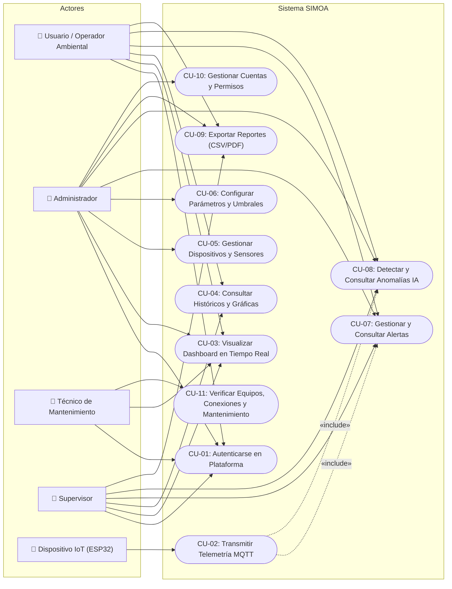

---

#### 3.2.2 Diagramas de Casos de Uso Específicos

A continuación se detallan los **11 diagramas de casos de uso específicos** que se desprenden del diagrama general, numerados y organizados por módulos y procesos del sistema.

---

##### MÓDULO 1: SEGURIDAD Y CONTROL DE ACCESO

###### Diagrama 3.2.2.1 — CU-01: Autenticación en Plataforma (Inicio de Sesión)
Este diagrama detalla el proceso de validación de identidad y emisión de credenciales de sesión para todos los perfiles autorizados del sistema.

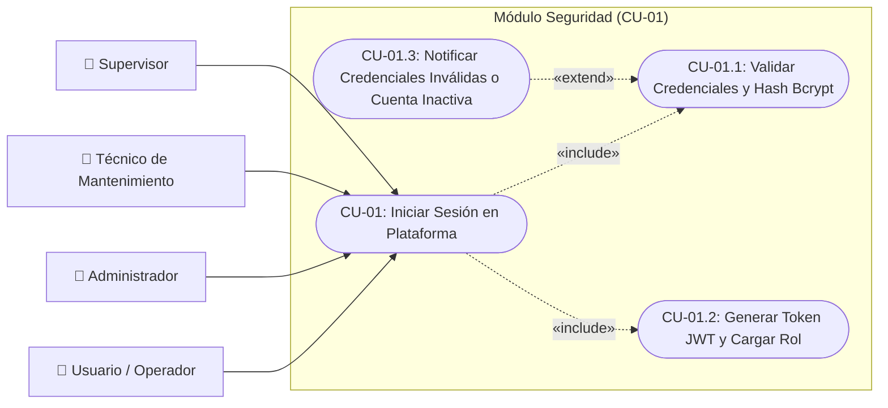

- **Nombre del caso de uso:** Autenticación en Plataforma (Inicio de Sesión).
- **Actores que participan:** Usuario (Operador Ambiental), Administrador, Técnico de Mantenimiento, Supervisor.
- **Objetivo del caso de uso:** Verificar la identidad del actor mediante sus credenciales y otorgar acceso controlado según su rol asignado.
- **Descripción breve del proceso:** El usuario ingresa su correo electrónico y contraseña en la pantalla de acceso; el backend en FastAPI verifica el hash en MySQL y retorna un token JWT con el perfil correspondiente.
- **Condiciones previas:** El actor debe contar con una cuenta registrada y activa en la tabla `usuarios` de la base de datos.
- **Condiciones posteriores:** Sesión autenticada mediante token Bearer JWT almacenado en el cliente web y redirección al panel correspondiente al rol.
- **Flujo principal de eventos:**
  1. El actor accede al formulario de inicio de sesión en la interfaz web.
  2. Ingresa su correo electrónico y contraseña y envía la solicitud (`POST /api/auth/login`).
  3. El sistema incluye la validación del usuario y el cotejo del hash `bcrypt` (`CU-01.1`).
  4. El sistema incluye la generación del token JWT firmado con vigencia de 8 horas y la carga de permisos por rol (`CU-01.2`).
  5. La plataforma redirige al actor al Dashboard de SIMOA.
- **Flujos alternativos:**
  - *FA-01 (Credenciales erróneas):* Si el correo o la contraseña no coinciden, se extiende el flujo (`CU-01.3`) mostrando el mensaje *"Correo o contraseña incorrectos"* y denegando el acceso.
  - *FA-02 (Cuenta deshabilitada):* Si el usuario está marcado como inactivo, el sistema bloquea el ingreso e indica contactar al Administrador.
- **Relaciones UML:** `«include»` hacia `CU-01.1` y `CU-01.2` (obligatorias en cada inicio de sesión exitoso); `«extend»` desde `CU-01.3` (condicional ante fallo de validación).

---

###### Diagrama 3.2.2.2 — CU-10: Gestión de Cuentas de Usuario y Asignación de Permisos
Detalla la administración exclusiva de cuentas de usuario y la asignación de roles/permisos dentro de la plataforma.

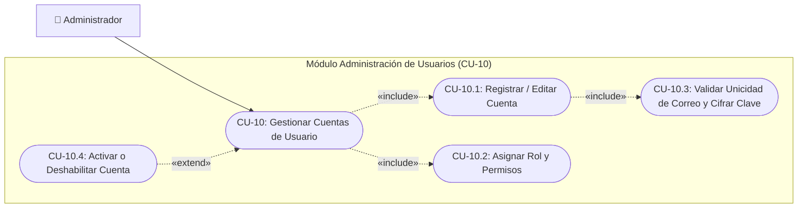

- **Nombre del caso de uso:** Gestión de Cuentas de Usuario y Asignación de Permisos.
- **Actores que participan:** Administrador.
- **Objetivo del caso de uso:** Permitir al Administrador crear, modificar y controlar las cuentas de acceso y los permisos por rol (`Administrador`, `Usuario`, `Técnico de Mantenimiento`, `Supervisor`).
- **Descripción breve del proceso:** El Administrador administra el catálogo de usuarios del sistema, garantizando la unicidad del correo electrónico, el cifrado seguro de contraseñas y la correcta asignación de privilegios.
- **Condiciones previas:** El Administrador debe haber iniciado sesión (`CU-01`) con rol autorizado.
- **Condiciones posteriores:** Cuenta creada, actualizada o deshabilitada en la tabla `usuarios`, reflejando de inmediato los permisos efectivos en futuros inicios de sesión.
- **Flujo principal de eventos:**
  1. El Administrador ingresa a la sección de gestión de usuarios.
  2. Selecciona crear una nueva cuenta o editar una existente (`CU-10.1`).
  3. Ingresa nombre, correo electrónico, contraseña inicial y selecciona el perfil de rol/permisos (`CU-10.2`).
  4. El sistema valida que el correo no exista previamente y cifra la contraseña con `bcrypt` (`CU-10.3`).
  5. El sistema guarda los cambios en MySQL y confirma la operación en pantalla.
- **Flujos alternativos:**
  - *FA-01 (Correo duplicado):* Si el correo ya existe (RN-01), el sistema rechaza el registro e informa que debe ser único.
  - *FA-02 (Cambio de estado):* El Administrador puede activar o deshabilitar una cuenta existente (`CU-10.4`) sin eliminar su historial de auditoría.
- **Relaciones UML:** `«include»` hacia `CU-10.1`, `CU-10.2` y `CU-10.3`; `«extend»` desde `CU-10.4` para suspensión/reactivación opcional.

---

##### MÓDULO 2: ADQUISICIÓN Y COMUNICACIÓN IOT (ESP32, MQTT, NODE-RED Y PYTHON)

###### Diagrama 3.2.2.3 — CU-02: Transmisión, Mediación e Ingestión de Telemetría MQTT
Describe el flujo completo de captura ambiental en campo, publicación mediante MQTT, mediación en Node-RED y recepción asíncrona en el backend Python.

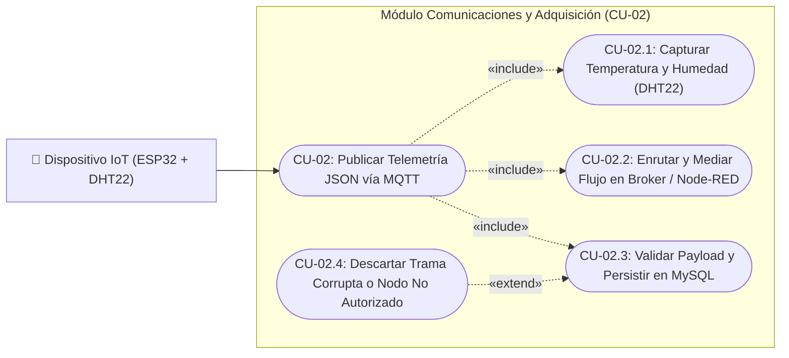

- **Nombre del caso de uso:** Transmisión, Mediación e Ingestión de Telemetría MQTT.
- **Actores que participan:** Dispositivo IoT (ESP32 + DHT22).
- **Objetivo del caso de uso:** Adquirir lecturas ambientales periódicas en campo, transmitirlas mediante el protocolo MQTT y almacenarlas de forma confiable en la base de datos.
- **Descripción breve del proceso:** Cada 5 a 10 segundos el ESP32 lee el sensor DHT22, empaqueta la lectura en JSON y la publica al broker Eclipse Mosquitto; Node-RED supervisa/enruta los flujos y FastAPI consume el tópico para persistir los datos en MySQL y disparar evaluación de alertas e IA.
- **Condiciones previas:** Nodo ESP32 conectado a Wi-Fi, registrado como activo en el sistema y broker Mosquitto operativo.
- **Condiciones posteriores:** Nueva medición almacenada en `mediciones` con marca de tiempo UTC, última conexión del nodo actualizada y evaluación de umbrales/IA ejecutada.
- **Flujo principal de eventos:**
  1. El ESP32 lee los valores de temperatura (°C) y humedad relativa (%HR) desde el sensor DHT22 (`CU-02.1`).
  2. Construye el paquete JSON y lo publica en el tópico `simoa/dispositivos/{codigo}/telemetria` (`CU-02`).
  3. El broker Mosquitto y Node-RED reciben y enrutan el mensaje hacia el consumidor backend (`CU-02.2`).
  4. FastAPI valida que el dispositivo esté registrado, comprueba rangos físicos válidos (RN-02) e inserta el registro en MySQL (`CU-02.3`).
  5. El backend invoca la evaluación de alertas (`CU-07`) y el análisis estadístico de IA (`CU-08`).
- **Flujos alternativos:**
  - *FA-01 (Payload malformado o lectura física fuera de escala):* Si el JSON es inválido o excede los límites físicos del DHT22 (`<-10 °C` o `>60 °C`), se extiende hacia `CU-02.4` registrando el error en el log sin contaminar las mediciones ni disparar falsas alarmas.
- **Relaciones UML:** `«include»` hacia `CU-02.1`, `CU-02.2` y `CU-02.3`; `«extend»` desde `CU-02.4` ante paquetes defectuosos o dispositivos no reconocidos.

---

##### MÓDULO 3: MONITOREO AMBIENTAL Y ANALÍTICA

###### Diagrama 3.2.2.4 — CU-03: Visualización del Dashboard Ambiental en Tiempo Real
Representa la consulta en vivo de temperatura, humedad relativa y estado de los nodos ambientales por parte de los cuatro perfiles humanos.

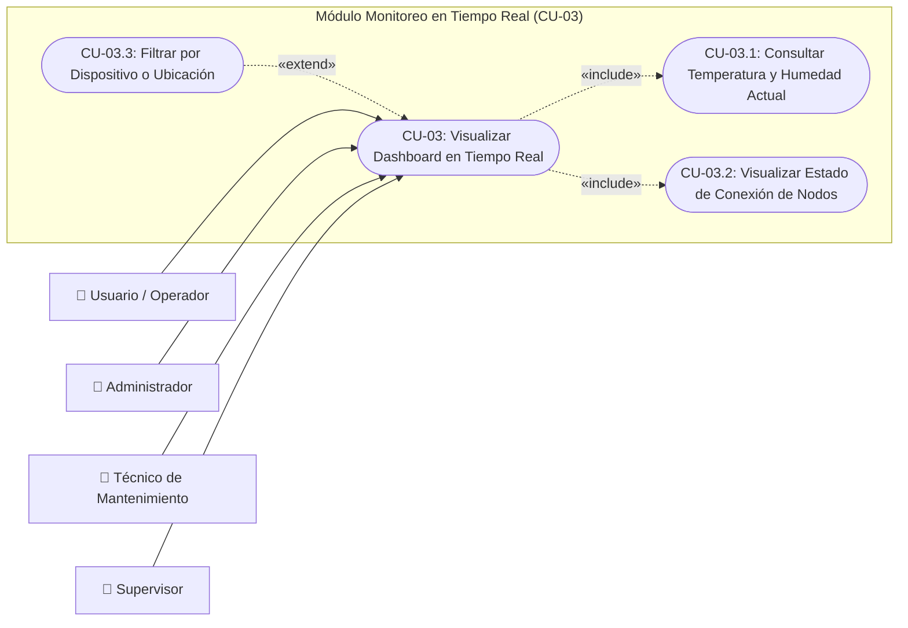

- **Nombre del caso de uso:** Visualización del Dashboard Ambiental en Tiempo Real.
- **Actores que participan:** Usuario (Operador Ambiental), Administrador, Técnico de Mantenimiento, Supervisor.
- **Objetivo del caso de uso:** Permitir la supervisión continua e inmediata de las variables ambientales actuales y del estado operativo de los dispositivos.
- **Descripción breve del proceso:** Al ingresar al panel principal, el cliente React consulta periódicamente la API REST (`/api/mediciones/actuales`) y renderiza tarjetas KPI, tacómetros, códigos de color por estado y resumen de nodos activos.
- **Condiciones previas:** Actor autenticado en la plataforma (`CU-01`) y al menos un dispositivo registrado.
- **Condiciones posteriores:** Variables actuales desplegadas en pantalla y actualizadas automáticamente sin recargar la página.
- **Flujo principal de eventos:**
  1. El actor accede al Dashboard principal tras autenticarse.
  2. La interfaz solicita al backend las últimas lecturas registradas por dispositivo.
  3. El sistema incluye la renderización de temperatura (°C) y humedad relativa (%HR) actuales (`CU-03.1`).
  4. El sistema incluye la visualización del estado de red de cada nodo (`En línea` / `Desconectado` / `Alerta`) (`CU-03.2`).
  5. El panel actualiza automáticamente las cifras conforme arriban nuevas mediciones.
- **Flujos alternativos:**
  - *FA-01 (Selección de ubicación específica):* El actor puede filtrar el panel por aula, laboratorio o dispositivo específico (`CU-03.3`).
- **Relaciones UML:** `«include»` hacia `CU-03.1` y `CU-03.2`; `«extend»` desde `CU-03.3` para filtrado por recinto.

---

###### Diagrama 3.2.2.5 — CU-04: Consulta de Historiales y Visualización de Gráficas
Detalla la exploración retrospectiva de mediciones y la generación interactiva de gráficas de tendencia temporal.

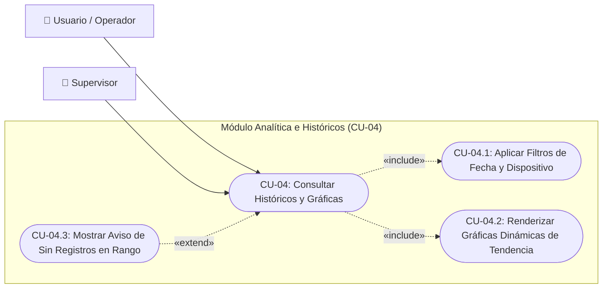

- **Nombre del caso de uso:** Consulta de Historiales y Visualización de Gráficas.
- **Actores que participan:** Usuario (Operador Ambiental), Supervisor.
- **Objetivo del caso de uso:** Consultar el comportamiento histórico de temperatura y humedad en un intervalo temporal y visualizarlo mediante gráficas interactivas.
- **Descripción breve del proceso:** El actor selecciona un dispositivo y rango de fechas; el backend consulta los registros indexados en MySQL (`/api/mediciones/historico`) y el frontend dibuja la tabla paginada y las curvas de temperatura/humedad con Chart.js.
- **Condiciones previas:** Actor autenticado y existencia de registros históricos en la tabla `mediciones`.
- **Condiciones posteriores:** Gráfica interactiva y tabla de histórico presentadas en pantalla.
- **Flujo principal de eventos:**
  1. El actor ingresa al módulo de Históricos y Analítica.
  2. Selecciona el dispositivo/sensor y define la fecha inicial y final (`CU-04.1`).
  3. El sistema consulta los registros ordenados cronológicamente en MySQL.
  4. El sistema incluye la renderización de la gráfica de líneas de temperatura y humedad con tooltips interactivos (`CU-04.2`).
  5. El actor explora los puntos de la serie temporal y navega por la tabla paginada.
- **Flujos alternativos:**
  - *FA-01 (Sin datos en el rango):* Si no existen mediciones para las fechas seleccionadas, se extiende hacia `CU-04.3` mostrando un mensaje informativo sin error de sistema.
- **Relaciones UML:** `«include»` hacia `CU-04.1` y `CU-04.2`; `«extend»` desde `CU-04.3`.

---

##### MÓDULO 4: GESTIÓN DE INFRAESTRUCTURA Y MANTENIMIENTO

###### Diagrama 3.2.2.6 — CU-05: Gestión de Dispositivos IoT y Sensores Ambientales
Detalla el ciclo de administración de nodos ESP32, asignación de ubicación física y vinculación de sensores DHT22.

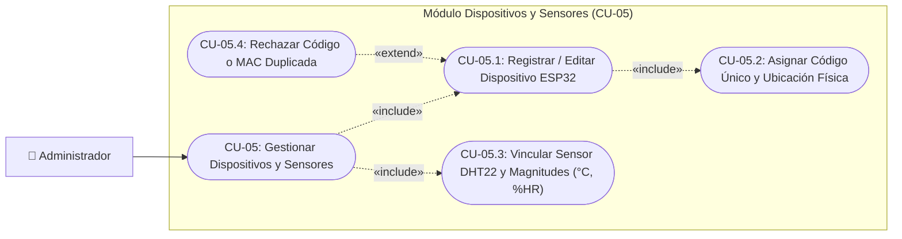

- **Nombre del caso de uso:** Gestión de Dispositivos IoT y Sensores Ambientales.
- **Actores que participan:** Administrador.
- **Objetivo del caso de uso:** Registrar, actualizar y organizar los nodos microcontroladores ESP32 y sus sensores DHT22 asociados en cada espacio físico.
- **Descripción breve del proceso:** El Administrador da de alta un nuevo dispositivo IoT con su identificador único y ubicación física, y le asocia los sensores digitales con sus magnitudes y pines GPIO correspondientes.
- **Condiciones previas:** El Administrador debe estar autenticado (`CU-01`).
- **Condiciones posteriores:** Dispositivo y sensores guardados en las tablas `dispositivos` y `sensores`, habilitados para recibir telemetría MQTT.
- **Flujo principal de eventos:**
  1. El Administrador accede al módulo de Gestión de Dispositivos.
  2. Selecciona registrar un nuevo nodo o editar uno existente (`CU-05.1`).
  3. Define el código único (ej. `ESP32-LAB01`), nombre, dirección MAC y ubicación física (`CU-05.2`).
  4. Asocia el sensor DHT22 indicando tipo, modelo, pin GPIO y magnitudes (`Temperatura °C`, `Humedad %HR`) (`CU-05.3`).
  5. El sistema persiste la configuración en MySQL y actualiza el inventario visible.
- **Flujos alternativos:**
  - *FA-01 (Código duplicado):* Si el código del ESP32 ya existe (RN-01), se extiende hacia `CU-05.4` solicitando un identificador único.
- **Relaciones UML:** `«include»` hacia `CU-05.1`, `CU-05.2` y `CU-05.3`; `«extend»` desde `CU-05.4`.

---

###### Diagrama 3.2.2.7 — CU-11: Verificación de Estado de Equipos, Conexiones y Mantenimiento Técnico
Detalla las operaciones técnicas de supervisión de conectividad, diagnóstico físico de nodos/sensores y registro de mantenimiento establecidas en el SRS.

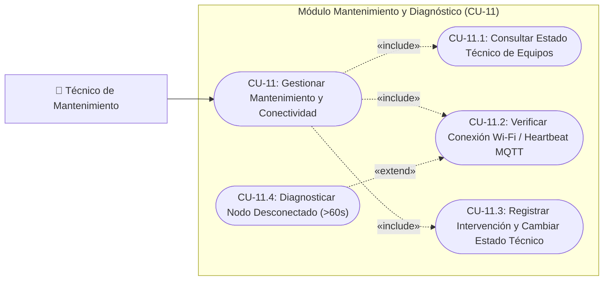

- **Nombre del caso de uso:** Verificación de Estado de Equipos, Conexiones y Mantenimiento Técnico.
- **Actores que participan:** Técnico de Mantenimiento.
- **Objetivo del caso de uso:** Permitir al Técnico supervisar la salud física y conectividad de los equipos ESP32/DHT22 y registrar las actividades de mantenimiento preventivo o correctivo.
- **Descripción breve del proceso:** El Técnico consulta la ficha técnica e historial de cada dispositivo, verifica su estado de enlace MQTT (en línea/desconectado según RN-03), realiza calibración o revisión en sitio y actualiza el estado del equipo (`Activo` o `Mantenimiento`).
- **Condiciones previas:** El Técnico de Mantenimiento debe estar autenticado en la plataforma (`CU-01`) y existir dispositivos registrados.
- **Condiciones posteriores:** Estado operativo del equipo actualizado en la tabla `dispositivos` (`Activo`/`Mantenimiento`) y verificación de conectividad completada.
- **Flujo principal de eventos:**
  1. El Técnico ingresa al listado y ficha técnica de dispositivos (`RF-19`, `RF-20`).
  2. Consulta el estado operativo actual de cada equipo y sus sensores asociados (`CU-11.1`).
  3. Verifica la marca de última conexión (`ultima_conexion`) y latido MQTT para comprobar la estabilidad de red (`CU-11.2`).
  4. Ejecuta la inspección, limpieza o calibración de hardware y registra el cambio de estado o intervención técnica (`CU-11.3`).
  5. Al finalizar la labor, restablece el dispositivo a estado `Activo` y comprueba la reanudación de lecturas en el Dashboard.
- **Flujos alternativos:**
  - *FA-01 (Equipo desconectado):* Si un nodo supera los 60 segundos sin emitir paquetes (RN-03 / `RF-15`), el sistema lo marca como `DESCONECTADO` y se extiende el flujo hacia `CU-11.4` para inspección física de alimentación o señal Wi-Fi.
- **Relaciones UML:** `«include»` hacia `CU-11.1`, `CU-11.2` y `CU-11.3`; `«extend»` desde `CU-11.4`.

---

##### MÓDULO 5: ALERTAS, INTELIGENCIA ARTIFICIAL Y REPORTES

###### Diagrama 3.2.2.8 — CU-06: Configuración de Parámetros y Umbrales de Alerta
Detalla la parametrización del sistema y la definición de rangos operativos seguros por sensor.

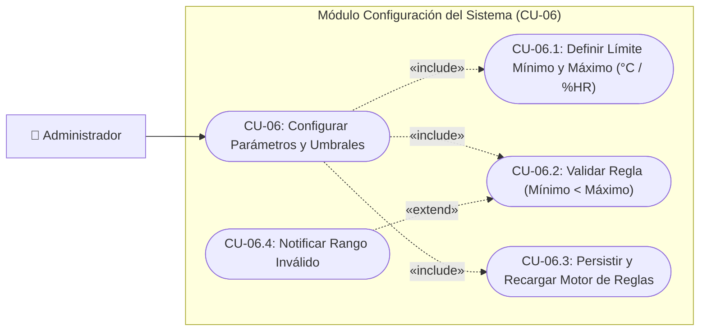

- **Nombre del caso de uso:** Configuración de Parámetros y Umbrales de Alerta.
- **Actores que participan:** Administrador.
- **Objetivo del caso de uso:** Establecer los límites mínimos y máximos permitidos de temperatura y humedad y activar/desactivar las reglas de evaluación ambiental.
- **Descripción breve del proceso:** El Administrador selecciona un sensor, ajusta sus parámetros operativos (`valor_minimo`, `valor_maximo`, estado activo) mediante `POST /api/configuraciones` y el backend valida la consistencia lógica antes de actualizar el motor de alertas.
- **Condiciones previas:** Administrador autenticado y sensor previamente registrado (`CU-05`).
- **Condiciones posteriores:** Configuración guardada en la tabla `configuraciones` y aplicada de inmediato a las siguientes mediciones entrantes.
- **Flujo principal de eventos:**
  1. El Administrador accede al módulo de Configuración Ambiental.
  2. Selecciona el dispositivo y el sensor a parametrizar.
  3. Ingresa los valores mínimo y máximo permitidos y habilita las alertas (`CU-06.1`).
  4. El sistema valida que `valor_minimo < valor_maximo` y que no haya campos nulos (`CU-06.2`).
  5. El sistema guarda la configuración en MySQL y recarga las reglas en memoria (`CU-06.3`).
- **Flujos alternativos:**
  - *FA-01 (Umbral inconsistente):* Si `valor_minimo >= valor_maximo`, se extiende hacia `CU-06.4` mostrando el error correspondiente y cancelando el guardado.
- **Relaciones UML:** `«include»` hacia `CU-06.1`, `CU-06.2` y `CU-06.3`; `«extend»` desde `CU-06.4`.

---

###### Diagrama 3.2.2.9 — CU-07: Generación, Consulta y Gestión de Alertas Ambientales
Modela tanto la generación automática de alertas ante desbordes de umbral como su consulta y seguimiento por parte de los actores autorizados.

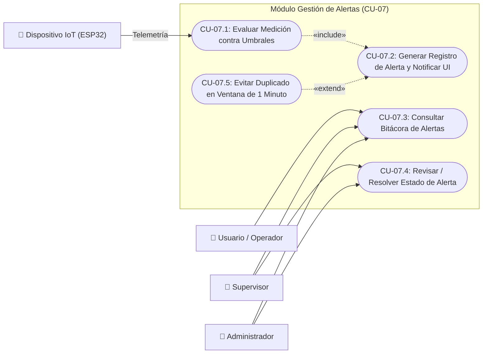

- **Nombre del caso de uso:** Generación, Consulta y Gestión de Alertas Ambientales.
- **Actores que participan:** Dispositivo IoT (ESP32 - disparador vía telemetría), Usuario (consulta), Supervisor (consulta y gestión de estado), Administrador (consulta y gestión de estado).
- **Objetivo del caso de uso:** Detectar automáticamente condiciones ambientales fuera de rango, notificar en pantalla y permitir el seguimiento de su estado (`Activa`, `Revisada`, `Resuelta`).
- **Descripción breve del proceso:** Cada lectura entrante es comparada contra los umbrales activos; si los supera, se registra una alerta en MySQL y se muestra visualmente en el Dashboard para que el Usuario la consulte y el Supervisor/Administrador gestionen su atención.
- **Condiciones previas:** Umbrales configurados (`CU-06`) y flujo de telemetría activo (`CU-02`).
- **Condiciones posteriores:** Alerta registrada en `alertas`, notificada visualmente en el panel y actualizada tras su revisión o resolución.
- **Flujo principal de eventos:**
  1. Al llegar una medición, el motor de reglas compara el valor contra `valor_minimo` y `valor_maximo` (`CU-07.1`).
  2. Al detectar desborde, crea la alerta con estado `Activa` y emite la notificación visual en el Dashboard (`CU-07.2`).
  3. El Usuario, Supervisor o Administrador consultan la lista y bitácora histórica de alertas (`CU-07.3`).
  4. El Supervisor o Administrador revisan la incidencia y actualizan su estado a `Revisada` o `Resuelta` (`CU-07.4`).
- **Flujos alternativos:**
  - *FA-01 (Prevención de spam de alertas):* Si ya existe una alerta activa en la misma franja de 1 minuto (RN-06), se extiende hacia `CU-07.5` evitando duplicados.
- **Relaciones UML:** `«include»` de `CU-07.1` hacia `CU-07.2`; `«extend»` desde `CU-07.5`.

---

###### Diagrama 3.2.2.10 — CU-08: Detección y Consulta de Anomalías mediante Inteligencia Artificial
Detalla el análisis estadístico no supervisado ejecutado en Python (`Isolation Forest`) y la visualización de resultados atípicos en el Dashboard.

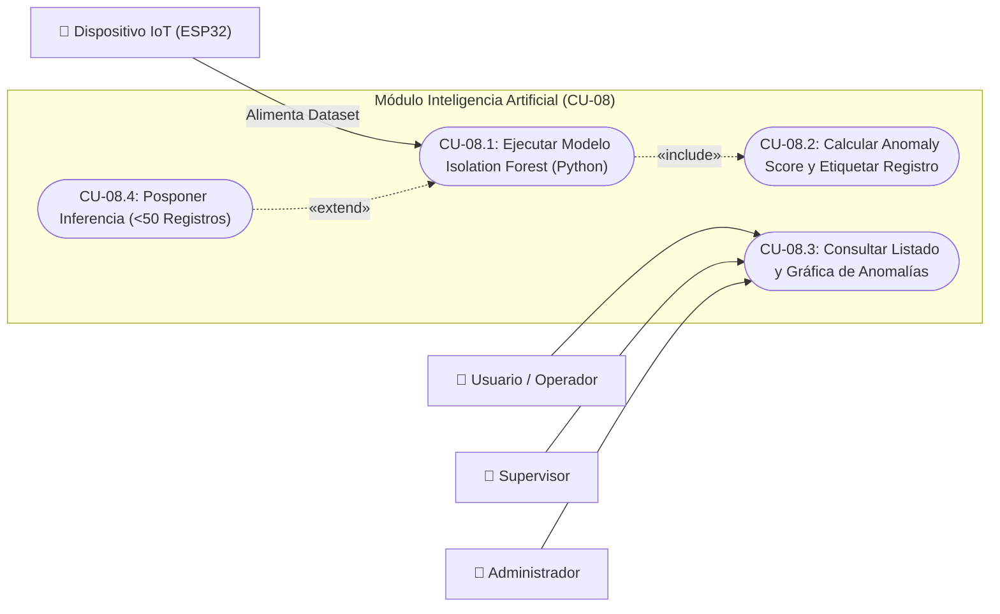

- **Nombre del caso de uso:** Detección y Consulta de Anomalías mediante Inteligencia Artificial.
- **Actores que participan:** Dispositivo IoT (ESP32 - fuente de datos), Usuario, Supervisor, Administrador.
- **Objetivo del caso de uso:** Identificar automáticamente comportamientos atípicos en temperatura y humedad mediante `Isolation Forest` y presentarlos de forma clara en el panel analítico.
- **Descripción breve del proceso:** Una tarea en segundo plano de FastAPI/Scikit-learn analiza ventanas recientes de mediciones (`[T, H, ΔT/Δt]`), marca las muestras anómalas en MySQL y las expone en `/api/ia/anomalias` para auditoría visual.
- **Condiciones previas:** Al menos 50 mediciones históricas almacenadas para el sensor evaluado.
- **Condiciones posteriores:** Mediciones evaluadas con `es_anomalia_ia` y `score_anomalia` actualizados en la tabla `mediciones`.
- **Flujo principal de eventos:**
  1. El servicio en segundo plano extrae las últimas $N$ mediciones de temperatura y humedad (`CU-08.1`).
  2. Normaliza los vectores y calcula el `anomaly_score`, etiquetando los valores atípicos (`CU-08.2`).
  3. El Usuario, Supervisor o Administrador ingresan a la vista de Análisis de Anomalías (`CU-08.3`).
  4. El sistema muestra la gráfica diferenciada y el listado de lecturas marcadas como anómalas.
- **Flujos alternativos:**
  - *FA-01 (Dataset insuficiente):* Si hay menos de 50 mediciones registradas, se extiende hacia `CU-08.4` posponiendo la inferencia sin generar errores al usuario.
- **Relaciones UML:** `«include»` hacia `CU-08.2`; `«extend»` desde `CU-08.4`.

---

###### Diagrama 3.2.2.11 — CU-09: Generación y Exportación de Reportes Ambientales (CSV/PDF)
Describe el proceso de consolidación y descarga de reportes históricos para auditoría y análisis externo.

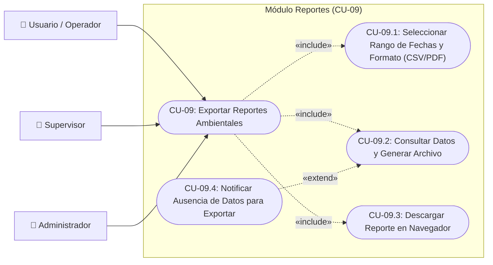

- **Nombre del caso de uso:** Generación y Exportación de Reportes Ambientales (CSV/PDF).
- **Actores que participan:** Usuario (Operador Ambiental), Supervisor, Administrador.
- **Objetivo del caso de uso:** Consolidar mediciones históricas en archivos descargables CSV o PDF para análisis en herramientas externas o auditorías de calidad.
- **Descripción breve del proceso:** El actor filtra las fechas y formato deseado; el backend extrae las lecturas de MySQL (`/api/reportes/exportar`), construye el archivo tabular o documento y lo entrega al navegador para descarga directa.
- **Condiciones previas:** Actor autenticado (`CU-01`) y existencia de mediciones dentro del periodo consultado.
- **Condiciones posteriores:** Archivo `.csv` o `.pdf` generado y descargado correctamente en el equipo del usuario.
- **Flujo principal de eventos:**
  1. El actor accede al módulo de Reportes.
  2. Selecciona el rango de fechas, dispositivo(s) y formato de salida (`CSV` o `PDF`) (`CU-09.1`).
  3. El backend consulta los registros y construye el archivo con encabezados limpios (`CU-09.2`).
  4. El navegador inicia la descarga automática del reporte (`CU-09.3`).
- **Flujos alternativos:**
  - *FA-01 (Sin registros):* Si el filtro no arroja mediciones, se extiende hacia `CU-09.4` informando al usuario antes de descargar un archivo vacío.
- **Relaciones UML:** `«include»` hacia `CU-09.1`, `CU-09.2` y `CU-09.3`; `«extend»` desde `CU-09.4`.

---

#### 3.2.3 Matriz de Coherencia (Actores, Casos de Uso, Módulos y Requisitos Funcionales)

| Actor | Casos de Uso Asociados | Módulos del Sistema | Requisitos Funcionales |
| :--- | :--- | :--- | :--- |
| **Administrador** | CU-01, CU-03, CU-05, CU-06, CU-07, CU-08, CU-09, CU-10 | Seguridad, Administración de Usuarios, Dashboard, Dispositivos y Sensores, Alertas, IA, Reportes | RF-01 a RF-05, RF-08 a RF-14, RF-16 a RF-20 |
| **Usuario (Operador Ambiental)** | CU-01, CU-03, CU-04, CU-07, CU-08, CU-09 | Seguridad, Dashboard, Históricos y Analítica, Alertas, IA, Reportes | RF-01, RF-08 a RF-11, RF-14, RF-16 a RF-18 |
| **Técnico de Mantenimiento** | CU-01, CU-03, CU-11 | Seguridad, Dashboard, Dispositivos y Monitoreo / Mantenimiento | RF-01, RF-08, RF-09, RF-15, RF-19, RF-20 |
| **Supervisor** | CU-01, CU-03, CU-04, CU-07, CU-08, CU-09 | Seguridad, Dashboard, Históricos, Alertas, IA, Reportes | RF-01, RF-08 a RF-11, RF-13, RF-14, RF-16 a RF-18 |
| **Dispositivo IoT (ESP32)** | CU-02 (dispara CU-07 y CU-08) | Comunicaciones MQTT, Persistencia, Alertas, IA | RF-06, RF-07, RF-13, RF-15, RF-18 |

---

### 3.3 Catálogo y Fichas Técnicas de Requerimientos Funcionales

| Código | Requisito Funcional | Prioridad | Módulo |
| :--- | :--- | :--- | :--- |
| **RF-01** | Autenticación y Control de Acceso por Roles (JWT) | Alta | Seguridad |
| **RF-02** | Registro y Administración de Dispositivos IoT | Alta | Dispositivos |
| **RF-03** | Asignación de Nombres, Códigos y Ubicaciones Físicas | Media | Dispositivos |
| **RF-04** | Registro y Vinculación de Sensores DHT22 | Alta | Sensores |
| **RF-05** | Configuración de Magnitudes y Variables Monitoreadas | Media | Sensores |
| **RF-06** | Ingestión y Recepción Continua de Telemetría por MQTT | Alta | Comunicaciones |
| **RF-07** | Almacenamiento Persistente de Mediciones en Base de Datos | Alta | Persistencia |
| **RF-08** | Visualización en Tiempo Real de la Temperatura Actual (°C) | Alta | Dashboard |
| **RF-09** | Visualización en Tiempo Real de la Humedad Relativa (%HR) | Alta | Dashboard |
| **RF-10** | Consulta y Filtrado Histórico de Mediciones | Alta | Históricos |
| **RF-11** | Generación de Gráficos de Tendencia Dinámicos | Alta | Analítica |
| **RF-12** | Configuración de Umbrales Mínimos y Máximos de Alerta | Alta | Alertas |
| **RF-13** | Detección Automática y Emisión de Alertas por Desborde | Alta | Alertas |
| **RF-14** | Bitácora y Registro Histórico de Eventos de Alerta | Media | Alertas |
| **RF-15** | Detección de Caídas de Red y Dispositivos Desconectados | Media | Monitoreo |
| **RF-16** | Generación y Descarga de Reportes Ambientales | Media | Reportes |
| **RF-17** | Exportación de Datos en Formato Tabular CSV | Media | Reportes |
| **RF-18** | Detección de Anomalías Estadísticas mediante IA (Isolation Forest) | Alta | Inteligencia Artificial |
| **RF-19** | Monitoreo y Marcación Visual del Estado de Conexión | Alta | Dashboard |
| **RF-20** | Ficha Técnica Detallada e Historial por Dispositivo | Media | Dispositivos |

---

#### Fichas Técnicas Detalladas de Requerimientos Funcionales

##### Ficha RF-01: Autenticación y Control de Acceso por Roles
| Campo | Especificación |
| :--- | :--- |
| **Identificador:** | **RF-01** |
| **Nombre:** | Inicio de Sesión y Autenticación Segura |
| **Tipo:** | Necesario |
| **¿Crítico?:** | Sí |
| **Prioridad:** | Alta |
| **Requerimientos asociados:** | RF-02, RF-05, RF-12, RF-13 |
| **Descripción:** | El sistema debe validar la identidad del usuario mediante correo electrónico y contraseña encriptada, generando un Token JWT firmado que delimita sus privilegios según el rol asignado (Administrador u Operador). |
| **Entradas:** | Correo electrónico, Contraseña en texto plano. |
| **Salidas:** | Token JWT de acceso, datos del perfil (nombre, rol), mensaje de confirmación o error de autenticación. |
| **Flujo Principal:** | 1. El usuario accede a la pantalla de Login e ingresa credenciales.<br>2. El sistema consulta la base de datos y compara el hash bcrypt.<br>3. Al autenticar con éxito, se genera el JWT con vigencia de 8 horas.<br>4. El frontend almacena el token y redirige al Dashboard correspondiente. |
| **Manejo Anormal:** | - Credenciales erróneas: Mostrar *"Correo o contraseña incorrectos"*; denegar acceso.<br>- Usuario inactivo: Mostrar *"Cuenta deshabilitada. Contacte al administrador"*. |
| **Reglas de Negocio:** | RN-01: Contraseñas con longitud mínima de 8 caracteres.<br>RN-02: Acceso protegido por token Bearer en todas las rutas privadas. |
| **Criterios de Aceptación:** | 1. Usuario registrado accede en menos de 1 segundo.<br>2. Credenciales inválidas no exponen detalles internos.<br>3. Redirección automática según rol. |

##### Ficha RF-06: Ingestión de Mediciones vía MQTT
| Campo | Especificación |
| :--- | :--- |
| **Identificador:** | **RF-06** |
| **Nombre:** | Ingestión y Recepción Continua de Telemetría por MQTT |
| **Tipo:** | Necesario |
| **¿Crítico?:** | Sí |
| **Prioridad:** | Alta |
| **Requerimientos asociados:** | RF-07, RF-08, RF-09, RF-13, RF-15 |
| **Descripción:** | El sistema debe suscribirse a los tópicos MQTT designados (`simoa/dispositivos/+/telemetria`) en el broker Mosquitto para recibir paquetes de telemetría emitidos por los nodos ESP32. |
| **Entradas:** | Mensaje MQTT en formato JSON conteniendo: `{ "codigo": "ESP32-01", "temperatura": 24.5, "humedad": 65.2, "timestamp": 1794575000 }`. |
| **Salidas:** | Mensaje recibido en el backend, validado y enrutado hacia el hilo de persistencia y al motor de reglas. |
| **Flujo Principal:** | 1. El ESP32 toma lecturas del DHT22 y publica el JSON en el broker.<br>2. El cliente MQTT del backend captura el mensaje publicado.<br>3. Se comprueba que el código del dispositivo exista en la base de datos.<br>4. Se despachan los valores a almacenamiento (RF-07) y evaluación de alertas (RF-13). |
| **Manejo Anormal:** | - Payload JSON malformado: Registrar en log de errores y descartar paquete.<br>- Dispositivo no reconocido: Registrar evento de nodo no autorizado. |
| **Reglas de Negocio:** | RN-03: Solo procesar paquetes de dispositivos activos.<br>RN-04: Intervalo nominal de recepción: 5 segundos. |
| **Criterios de Aceptación:** | 1. El broker recibe y despacha paquetes sin pérdidas a 1 msg/seg por nodo.<br>2. El backend procesa el payload en menos de 100 ms. |

##### Ficha RF-12: Configuración de Umbrales Ambientales
| Campo | Especificación |
| :--- | :--- |
| **Identificador:** | **RF-12** |
| **Nombre:** | Configuración de Límites y Umbrales Ambientales |
| **Tipo:** | Necesario |
| **¿Crítico?:** | Sí |
| **Prioridad:** | Alta |
| **Requerimientos asociados:** | RF-05, RF-13, RF-14 |
| **Descripción:** | El sistema debe permitir al Administrador definir rangos permitidos (temperatura mínima/máxima y humedad mínima/máxima) para cada sensor o ambiente monitoreado. |
| **Entradas:** | ID del sensor, `valor_minimo`, `valor_maximo`, estado activo/inactivo. |
| **Salidas:** | Registro de configuración actualizado, mensaje de confirmación en la UI. |
| **Flujo Principal:** | 1. El administrador ingresa al módulo de Configuración Ambiental.<br>2. Selecciona el sensor o dispositivo.<br>3. Ajusta los valores umbrales (ej. Min: 18°C, Max: 27°C; Humedad: 40% a 70%).<br>4. El sistema valida que el mínimo sea menor que el máximo.<br>5. Se actualiza la base de datos y se recarga el motor de reglas en memoria. |
| **Manejo Anormal:** | - `valor_minimo >= valor_maximo`: Mostrar mensaje *"El límite mínimo debe ser estrictamente menor que el límite máximo"*. |
| **Reglas de Negocio:** | RN-05: Los umbrales no pueden contener valores nulos ni negativos fuera de escala. |
| **Criterios de Aceptación:** | 1. Cambios de umbral entran en efecto inmediato para las siguientes mediciones. |

##### Ficha RF-13: Detección y Generación Automática de Alertas
| Campo | Especificación |
| :--- | :--- |
| **Identificador:** | **RF-13** |
| **Nombre:** | Generación Automática de Alertas por Desborde de Límites |
| **Tipo:** | Necesario |
| **¿Crítico?:** | Sí |
| **Prioridad:** | Alta |
| **Requerimientos asociados:** | RF-06, RF-08, RF-09, RF-12, RF-14 |
| **Descripción:** | Cada vez que entra una medición, el sistema compara el valor medido contra la configuración activa. Si supera los límites máximos o cae de los mínimos, se genera una alerta inmediata. |
| **Entradas:** | Medición entrante (temperatura o humedad), umbrales activos del sensor. |
| **Salidas:** | Inserción en la tabla `alertas`, emisión de notificación visual en el Dashboard (banner/toasts rojo). |
| **Flujo Principal:** | 1. Entra una medición (ej. 32.5 °C).<br>2. Se evalúa contra el límite máximo configurado (28.0 °C).<br>3. Al detectarse superación, se crea el registro con tipo *"CRÍTICA"*, estado *"ACTIVA"* y mensaje descriptivo.<br>4. El Dashboard resalta el dispositivo en color rojo con un indicador de campana. |
| **Manejo Anormal:** | - Error de base de datos al guardar alerta: Registrar en log del sistema y emitir por socket de emergencia. |
| **Reglas de Negocio:** | RN-06: Prevenir alertas duplicadas si el estado ya está activo en la misma franja de 1 minuto. |
| **Criterios de Aceptación:** | 1. La alerta se crea y se refleja en el frontend en menos de 2 segundos desde el arribo del paquete MQTT. |

##### Ficha RF-18: Detección de Anomalías por Machine Learning (IA)
| Campo | Especificación |
| :--- | :--- |
| **Identificador:** | **RF-18** |
| **Nombre:** | Detección de Anomalías mediante Algoritmo Isolation Forest |
| **Tipo:** | Innovador / Necesario |
| **¿Crítico?:** | No (funciona en complemento a las alertas por umbrales) |
| **Prioridad:** | Alta |
| **Requerimientos asociados:** | RF-07, RF-10, RF-11, RF-14 |
| **Descripción:** | Un proceso periódico en segundo plano entrena y aplica un modelo *Isolation Forest* sobre las series de tiempo de temperatura y humedad para descubrir comportamientos estadísticamente atípicos (pérdida súbita de correlación, microoscilaciones extrañas). |
| **Entradas:** | Dataset de las últimas $N$ mediciones (temperatura, humedad, delta temporal). |
| **Salidas:** | Marcación de registros con etiqueta `es_anomalia = true`, score de anomalía, visualización diferenciada en gráficos (puntos de color ámbar). |
| **Flujo Principal:** | 1. El servicio de IA consulta las mediciones de la última ventana temporal.<br>2. Normaliza los datos e infiere predicciones con el modelo entrenado.<br>3. Las muestras etiquetadas con $-1$ (anomalías) se almacenan con su índice de severidad.<br>4. El Dashboard ofrece una vista especializada para auditar las anomalías detectadas. |
| **Manejo Anormal:** | - Dataset insuficiente (< 50 registros): Suspender predicción hasta acumular histórico representativo sin arrojar error al usuario. |
| **Reglas de Negocio:** | RN-07: El modelo no bloquea las alertas por umbral fijo; ambas capas operan en paralelo. |
| **Criterios de Aceptación:** | 1. Identificación precisa de caídas o picos instantáneos que simulen fallas de sensor o ventilación.<br>2. Tiempo de inferencia inferior a 500 ms por lote. |

---

### 3.4 Catálogo y Fichas de Requerimientos No Funcionales

```
RNF-01: Usabilidad y Diseño Responsive (Mobile/Desktop)
RNF-02: Tiempo de Respuesta de la API (≤ 200 ms)
RNF-03: Eficiencia en Comunicación MQTT (QoS 0/1 bajo ancho de banda)
RNF-04: Seguridad y Cifrado de Contraseñas (Bcrypt / Argon2)
RNF-05: Control de Acceso por Tokens JWT
RNF-06: Rendimiento y Concurrencia (≥ 50 clientes simultáneos)
RNF-07: Integridad y Consistencia Transaccional (ACID en MySQL)
RNF-08: Modularidad y Clean Code en Python (PEP 8 / Estructura por capas)
RNF-09: Seguridad en Broker MQTT (ACLs y credenciales)
RNF-10: Mantenibilidad y Documentación OpenAPI (Swagger)
RNF-11: Tolerancia a Fallos y Copias de Respaldo (Scripts dump MySQL)
RNF-12: Precisión Temporal y Sincronización (NTP / Timestamps UTC)
```

##### Ficha RNF-01: Usabilidad y Diseño Responsive
| Atributo | Detalle |
| :--- | :--- |
| **Identificador:** | **RNF-01** |
| **Nombre:** | Interfaz Intuitiva y Diseño Adaptable |
| **Descripción:** | La aplicación web debe ofrecer una experiencia de usuario fluida, limpia y adaptada a dispositivos móviles, tabletas y computadores personales. |
| **Métrica:** | El 90% de los operadores no técnicos deben poder consultar la temperatura de un salón en menos de 10 segundos desde su acceso. Puntuación Lighthouse de accesibilidad ≥ 85. |
| **Reglas de Negocio:** | Diseño con Tailwind CSS y componentes visuales autoexplicativos. |

##### Ficha RNF-02: Tiempo de Respuesta de la API REST
| Atributo | Detalle |
| :--- | :--- |
| **Identificador:** | **RNF-02** |
| **Nombre:** | Rendimiento en Consultas Habituales |
| **Descripción:** | Los endpoints de consulta de mediciones, alertas y dispositivos deben responder con latencias mínimas para no congelar la interfaz. |
| **Métrica:** | Tiempo de respuesta $\le 200\text{ ms}$ en el 95% de las solicitudes HTTP para consultas ordinarias de mediciones recientes. |
| **Reglas de Negocio:** | Indexación de llaves foráneas y campos temporales en MySQL. |

##### Ficha RNF-04: Seguridad de Credenciales y Cifrado
| Atributo | Detalle |
| :--- | :--- |
| **Identificador:** | **RNF-04** |
| **Nombre:** | Almacenamiento Seguro de Contraseñas |
| **Descripción:** | Ninguna contraseña debe almacenarse en texto claro bajo ninguna circunstancia. |
| **Métrica:** | Empleo estricto de algoritmo de hashing robusto (`bcrypt` con salt factor $\ge 12$). |
| **Reglas de Negocio:** | Imposibilidad de reversión directa; validación exclusiva por cotejo de hashes. |

##### Ficha RNF-06: Rendimiento del Módulo de Inteligencia Artificial
| Atributo | Detalle |
| :--- | :--- |
| **Identificador:** | **RNF-06** |
| **Nombre:** | Eficiencia Computacional en Detección de Anomalías |
| **Descripción:** | El procesamiento de algoritmos de Machine Learning no debe comprometer la disponibilidad del servidor de aplicaciones. |
| **Métrica:** | El reentrenamiento o ejecución por lotes de *Isolation Forest* no debe superar el 30% del uso de CPU por más de 3 segundos consecutivos. |

---

### 3.5 Historias de Usuario (HU-01 a HU-13)

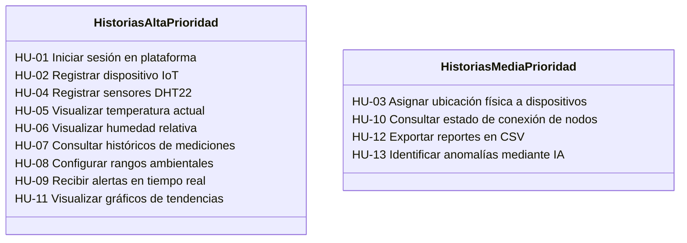

#### Detalle de Historias de Usuario

- **HU-01 (Alta):** *Como Administrador*, quiero iniciar sesión con credenciales seguras *para* acceder a las opciones de administración de SIMOA.  
  - *Criterios:* Acceso concedido ante email/password válidos; entrega de token JWT; denegación ante credenciales incorrectas.
- **HU-02 (Alta):** *Como Administrador*, quiero registrar dispositivos IoT *para* tener identificados los nodos ESP32 en el sistema.  
  - *Criterios:* Código de dispositivo único; validación de campos obligatorios; estado inicial *"Activo"*.
- **HU-03 (Media):** *Como Administrador*, quiero asignar una ubicación física a cada dispositivo *para* saber con exactitud en qué aula o laboratorio se efectúan las mediciones.  
  - *Criterios:* Campo de texto descriptivo (ej. "Laboratorio 3 - CIES"); editable en cualquier momento.
- **HU-04 (Alta):** *Como Administrador*, quiero asociar sensores DHT22 a cada nodo *para* especificar qué variables ambientales registra.  
  - *Criterios:* Definición de magnitud (temperatura/humedad), modelo del sensor, unidad de medida (°C, %HR).
- **HU-05 (Alta):** *Como Operador*, quiero visualizar la temperatura actual en tiempo real *para* verificar el confort térmico inmediato del ambiente.  
  - *Criterios:* Indicación numérica en °C, timestamp de última actualización, indicador visual de estado.
- **HU-06 (Alta):** *Como Operador*, quiero visualizar la humedad relativa actual *para* comprobar que los niveles de vapor de agua estén en rangos seguros.  
  - *Criterios:* Indicación en porcentaje (%HR), cambio de color según proximidad a límites.
- **HU-07 (Alta):** *Como Operador*, quiero consultar el historial de mediciones por rango de fechas *para* auditar comportamientos térmicos pasados.  
  - *Criterios:* Filtro por fecha inicial y final, tabla con paginación, opción de ordenamiento ascendente/descendente.
- **HU-08 (Alta):** *Como Administrador*, quiero configurar umbrales mínimos y máximos *para* establecer los límites seguros de operación ambiental.  
  - *Criterios:* Validación de `min < max`, persistencia inmediata, efecto reactivo en el analizador de telemetría.
- **HU-09 (Alta):** *Como Operador*, quiero recibir alertas visibles cuando una variable supere los umbrales *para* actuar oportunamente ante emergencias.  
  - *Criterios:* Notificación tipo banner/alerta visual en pantalla, registro del evento con hora, dispositivo y valor detectado.
- **HU-10 (Media):** *Como Administrador*, quiero ver el estado de conexión de los ESP32 *para* identificar nodos apagados o con problemas de señal Wi-Fi.  
  - *Criterios:* Si un nodo no transmite en más de 60 segundos, se marca visualmente como *"Desconectado"*.
- **HU-11 (Alta):** *Como Operador*, quiero ver gráficos de líneas dinámicos *para* analizar visualmente la tendencia de temperatura y humedad en el tiempo.  
  - *Criterios:* Curvas claras mediante Chart.js, diferenciación por color, tooltip interactivo con valores puntuales.
- **HU-12 (Media):** *Como Administrador*, quiero exportar las mediciones a un archivo CSV *para* analizarlas en herramientas externas como Excel o Python.  
  - *Criterios:* Descarga directa en navegador con encabezados limpios: `id, dispositivo, sensor, variable, valor, fecha_hora`.
- **HU-13 (Media):** *Como Operador*, quiero visualizar las anomalías marcadas por el modelo de IA *para* investigar comportamientos atípicos no detectados por los umbrales comunes.  
  - *Criterios:* Destacado visual en las gráficas con puntos de color distintivo; listado de anomalías con su puntaje de atipicidad.

---

### 3.6 Reglas de Negocio Consolidadas

- **RN-01 (Unicidad de Identificadores):** El código asignado a cada ESP32 (ej. `ESP32-LAB01`) y el correo de cada usuario deben ser estrictamente únicos en la base de datos.
- **RN-02 (Validación de Lecturas Ambientales):** Cualquier valor de temperatura inferior a $-10\text{ }^\circ\text{C}$ o superior a $60\text{ }^\circ\text{C}$, y de humedad inferior al $0\%$ o superior al $100\%$ se considerará lectura física defectuosa (falla en DHT22) y se marcará como error de hardware sin disparar alertas de evacuación.
- **RN-03 (Caducidad de Conexión - Keep-Alive):** Si el servidor no recibe paquetes de un dispositivo en un lapso mayor a 3 ciclos nominales (60 segundos), su estado cambiará automáticamente de `EN LÍNEA` a `DESCONECTADO`.
- **RN-04 (Inmutabilidad Histórica):** Las mediciones registradas en la tabla `mediciones` no podrán ser editadas ni eliminadas individualmente por ningún usuario para preservar la integridad de la auditoría.
- **RN-05 (Complementariedad de Alertas e IA):** Una alerta por umbral fijo tiene prioridad crítica; el módulo de IA genera advertencias de comportamiento anómalo que complementan el diagnóstico pero no anulan la alarma por temperatura extrema.

---

### 3.7 Requisitos del Sistema de Inteligencia Artificial

- **Algoritmo seleccionado:** *Isolation Forest* (Bosques de Aislamiento) implementado a través de `scikit-learn` en Python.
- **Variables de entrada:** Vector bidimensional $[T, H]$ compuesto por temperatura y humedad, complementado con la tasa de variación instantánea $\Delta T / \Delta t$.
- **Objetivo de detección:** Identificar descensos bruscos e injustificados (ej. sensor desconectado accidentalmente, corrientes súbitas de aire frío, congelamiento) o incrementos lentos y continuos con baja humedad que anticipan fallos mecánicos de ventilación.
- **Métricas e Indicadores:**
  - `contamination`: Parametrizado inicialmente al $5\%$ ($0.05$).
  - `anomaly_score`: Valor normalizado entre $-1$ (anomalía severa) y $1$ (lectura completamente regular).
- **Acción del sistema:** Las mediciones con etiqueta anómala se marcan con una bandera booleana en base de datos para visualización destacada en el frontend.

---

## 4. ARQUITECTURA DEL SISTEMA E INTEGRACIÓN IOT

### 4.1 Arquitectura en Capas IoT

```mermaid
flowchart TD
    subgraph "Capa de Adquisición (Edge IoT)"
        DHT["Sensor Digital DHT22\n(Temp & Humedad)"]
        ESP["Microcontrolador ESP32\n(Lectura GPIO + Wi-Fi)"]
        DHT -->|Señal Digital| ESP
    end

    subgraph "Capa de Transporte (Comunicaciones)"
        MQTTBroker["Broker MQTT Mosquitto\nPuerto 1883 / TCP"]
        ESP -->|Publicación MQTT (JSON)\nTópico: simoa/dispositivos/telemetria| MQTTBroker
    end

    subgraph "Capa de Mediación e Integración"
        NodeRED["Node-RED\n(Orquestación de flujos y pruebas)"]
        MQTTBroker <-->|Suscripción / Reenvío| NodeRED
    end

    subgraph "Capa de Negocio y Persistencia (Backend)"
        FastAPI["API Backend Python (FastAPI)\n- Controladores REST\n- Consumidor MQTT\n- Seguridad JWT"]
        MySQL[("Base de Datos Relacional\nMySQL 8.0")]
        IAModule["Módulo IA (Scikit-Learn)\nIsolation Forest Anomaly Engine"]

        MQTTBroker -->|Consumo Asíncrono| FastAPI
        NodeRED -.->|HTTP POST Opcional| FastAPI
        FastAPI <-->|SQLAlchemy / SQL| MySQL
        FastAPI <-->|Datasets & Scores| IAModule
    end

    subgraph "Capa de Presentación (Frontend)"
        Dashboard["Dashboard Web SPA (React + Tailwind + Chart.js)\n- Panel en Tiempo Real\n- Históricos\n- Gestión Alertas"]
        FastAPI -->|API REST (JSON) / HTTPs| Dashboard
    end
```

### 4.2 Flujo de Funcionamiento Paso a Paso
1. **Adquisición:** Cada 5 segundos, el microcontrolador ESP32 toma muestras de temperatura y humedad a través del pin GPIO digital conectado al DHT22.
2. **Empaquetado:** El ESP32 compone una cadena JSON con la estructura:
   ```json
   {
     "codigo_dispositivo": "ESP32-AULA01",
     "temperatura": 23.8,
     "humedad": 58.4,
     "timestamp": 1794576000
   }
   ```
3. **Publicación:** El ESP32 publica el paquete hacia el broker MQTT Mosquitto bajo el tópico `simoa/dispositivos/ESP32-AULA01/telemetria`.
4. **Recepción:** El servicio en segundo plano de FastAPI captura el mensaje mediante cliente `paho-mqtt` o `asyncio-mqtt`.
5. **Persistencia:** Se validan los datos y se insertan en la tabla `mediciones` de MySQL con clave foránea al sensor correspondiente.
6. **Reglas de Alerta:** El motor compara la temperatura y humedad contra los rangos mínimos y máximos activos. Si hay desborde, inserta un registro en la tabla `alertas`.
7. **Inferencia IA:** La tarea de IA evalúa la nueva tupla contra el modelo *Isolation Forest* y calcula si representa una anomalía.
8. **Visualización:** El Dashboard en React consulta periódicamente los endpoints REST y actualiza tacómetros, gráficos de líneas y badges de alerta en pantalla.

---

## 5. MODELO DE DATOS Y PERSISTENCIA

### 5.1 Diagrama Entidad-Relación (Mermaid)

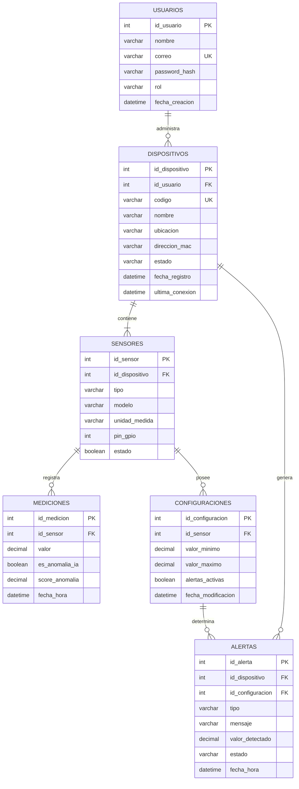

### 5.2 Diccionario de Datos Breve

| Tabla | Atributo Principal | Tipo | Restricción | Descripción |
| :--- | :--- | :--- | :--- | :--- |
| `usuarios` | `id_usuario` | INT | PK, AutoIncrement | Identificador primario de usuario. |
| `usuarios` | `correo` | VARCHAR(120) | UNIQUE, NOT NULL | Cuenta de correo para autenticación. |
| `dispositivos` | `codigo` | VARCHAR(50) | UNIQUE, NOT NULL | Código único del nodo IoT (ej. `ESP32-LAB01`). |
| `dispositivos` | `estado` | VARCHAR(20) | DEFAULT 'Activo' | `Activo`, `Inactivo`, `Mantenimiento`. |
| `sensores` | `tipo` | VARCHAR(30) | NOT NULL | Variable: `Temperatura`, `Humedad`. |
| `configuraciones` | `valor_minimo` | DECIMAL(5,2) | NOT NULL | Límite inferior permitido. |
| `configuraciones` | `valor_maximo` | DECIMAL(5,2) | NOT NULL | Límite superior permitido. |
| `mediciones` | `valor` | DECIMAL(5,2) | NOT NULL | Magnitud registrada (°C o %HR). |
| `mediciones` | `es_anomalia_ia` | BOOLEAN | DEFAULT FALSE | Clasificación generada por Isolation Forest. |
| `alertas` | `estado` | VARCHAR(20) | DEFAULT 'Activa' | `Activa`, `Revisada`, `Resuelta`. |

---

## 6. DISEÑO DE SERVICIOS Y API REST

La API REST sigue la convención estándar OpenAPI 3.0 implementada en FastAPI con rutas estructuradas bajo el prefijo `/api`:

| Método | Endpoint | Parámetros / Body | Descripción |
| :--- | :--- | :--- | :--- |
| `POST` | `/api/auth/login` | `{correo, password}` | Inicio de sesión, retorna Token Bearer JWT. |
| `GET` | `/api/dispositivos` | Header: `Authorization` | Lista de todos los dispositivos registrados. |
| `POST` | `/api/dispositivos` | `{codigo, nombre, ubicacion}` | Registro de un nuevo nodo ESP32 (Solo Admin). |
| `GET` | `/api/dispositivos/{id}` | Path: `id` | Detalle, sensores asociados y estado de conexión. |
| `PUT` | `/api/dispositivos/{id}` | `{nombre, ubicacion, estado}` | Actualización de parámetros de un dispositivo. |
| `GET` | `/api/sensores` | Query: `?dispositivo_id=1` | Catálogo de sensores activos por dispositivo. |
| `POST` | `/api/sensores` | `{id_dispositivo, tipo, modelo}` | Vinculación de un nuevo sensor. |
| `GET` | `/api/mediciones/actuales` | - | Últimas mediciones registradas por dispositivo. |
| `GET` | `/api/mediciones/historico`| Query: `?desde=...&hasta=...` | Lecturas históricas con filtros de tiempo. |
| `GET` | `/api/alertas` | Query: `?estado=Activa` | Listado de alertas pendientes y resueltas. |
| `POST` | `/api/configuraciones` | `{id_sensor, min, max}` | Definición o ajuste de rangos y umbrales. |
| `GET` | `/api/ia/anomalias` | Query: `?limite=50` | Lista de mediciones catalogadas como anómalas. |
| `GET` | `/api/reportes/exportar` | Query: `?formato=csv&desde=...`| Descarga directa de archivo CSV para auditoría. |

---

## 7. DISEÑO DE INTERFACES (UI/UX)

El sistema comprende las siguientes pantallas principales:
1. **Inicio de Sesión (Login):** Formulario minimalista con validación asíncrona, mensajes de error flotantes y gestión de sesión segura.
2. **Dashboard Principal de Monitoreo:**
   - **Tarjetas de Resumen (KPIs):** Temperatura promedio actual, Humedad relativa promedio, Nodos en línea / fuera de línea, Alertas activas.
   - **Selector de Dispositivo:** Menú desplegable para aislar la visualización por aula o laboratorio.
   - **Gráfica de Tendencia Temporal:** Gráfica interactiva de dos ejes (Temperatura en rojo/naranja, Humedad en azul) construida con Chart.js.
   - **Línea de Tiempo de Alertas:** Panel lateral con las últimas 5 alertas generadas en tiempo real.
3. **Módulo de Gestión de Dispositivos:** Tabla CRUD interactiva con búsqueda por texto y modal de creación/edición.
4. **Módulo de Configuración de Umbrales:** Control deslizante (Sliders) o inputs numéricos con vista previa del rango térmico admisible.
5. **Módulo de Análisis Inteligente de Anomalías:** Visualización de puntos dispersos (Scatter plot) donde se marcan en color ámbar/púrpura las lecturas señaladas por la Inteligencia Artificial.
6. **Módulo de Reportes:** Generador con calendario interactivo para exportar archivos `.csv`.


