# SERVICIO NACIONAL DE APRENDIZAJE – SENA
## CENTRO DE LA INDUSTRIA, LA EMPRESA Y LOS SERVICIOS (CIES)
### REGIONAL HUILA – NEIVA, HUILA
### PROGRAMA: TECNÓLOGO EN ANÁLISIS Y DESARROLLO DE SOFTWARE (ADSO)
**FICHA:** 3413988  
**AÑO:** 2026  

---

# ESPECIFICACIÓN DE REQUISITOS DE SOFTWARE (SRS)
## SISTEMA IOT DE MONITOREO AMBIENTAL (SIMOA)

```
        ███████╗██╗███╗   ███╗ ██████╗  █████╗ 
        ██╔════╝██║████╗ ████║██╔═══██╗██╔══██╗
        ███████╗██║██╔████╔██║██║   ██║███████║
        ╚════██║██║██║╚██╔╝██║██║   ██║██╔══██║
        ███████║██║██║ ╚═╝ ██║╚██████╔╝██║  ██║
        ╚══════╝╚═╝╚═╝     ╚═╝ ╚═════╝ ╚═╝  ╚═╝
  Sistema IoT de Monitoreo Ambiental con Detección de Anomalías por IA
```

**Presentado por:**  
- Luz Eliana Sánchez Tovar  

**Presentado a:**  
- Instructor: Javier Humberto Pinto  

**Fecha de emisión:** 13/11/2026  
**Versión del documento:** 1.0 (MVP)  

---

## ÍNDICE GENERAL

1. [Introducción](#1-introducción)
   - 1.1 Planteamiento del Problema
   - 1.2 Justificación
   - 1.3 Objetivo General y Objetivos Específicos
   - 1.4 Alcances (Funcionalidades Incluidas y Excluidas)
   - 1.5 Personal Involucrado y Roles
   - 1.6 Definiciones, Acrónimos y Abreviaturas
   - 1.7 Referencias Normativas
   - 1.8 Resumen Ejecutivo
2. [Descripción General](#2-descripción-general)
   - 2.1 Perspectiva del Producto
   - 2.2 Características de los Usuarios
   - 2.3 Restricciones Técnicas y Operativas
   - 2.4 Suposiciones y Dependencias
3. [Requisitos Específicos del Sistema](#3-requisitos-específicos-del-sistema)
   - 3.1 Requisitos Comunes de las Interfaces (UI, Hardware, Software, Comunicaciones)
   - 3.2 Diagramas de Casos de Uso (General, Específicos y Matriz de Coherencia)
   - 3.3 Catálogo y Fichas Detalladas de Requerimientos Funcionales (RF-01 al RF-20)
   - 3.4 Catálogo y Fichas Detalladas de Requerimientos No Funcionales (RNF-01 al RNF-12)
   - 3.5 Historias de Usuario (HU-01 a HU-13) con Criterios de Aceptación
   - 3.6 Reglas de Negocio Consolidadas
   - 3.7 Requisitos del Módulo de Inteligencia Artificial (Isolation Forest)
4. [Arquitectura del Sistema e Integración IoT](#4-arquitectura-del-sistema-e-integración-iot)
   - 4.1 Arquitectura en Capas IoT
   - 4.2 Diagrama de Flujo y Comunicación (Mermaid)
   - 4.3 Especificación de Tópicos MQTT y Payloads JSON
5. [Modelo de Datos y Persistencia](#5-modelo-de-datos-y-persistencia)
   - 5.1 Diagrama Entidad-Relación (Mermaid ER)
   - 5.2 Diccionario de Datos y Reglas de Integridad
6. [Diseño de Servicios y API REST](#6-diseño-de-servicios-y-api-rest)
7. [Diseño y Distribución de Interfaces (UI/UX)](#7-diseño-y-distribución-de-interfaces-uiux)

---

## 1. INTRODUCCIÓN

### 1.1 Planteamiento del Problema
En múltiples recintos cerrados —tales como aulas de formación, laboratorios de cómputo, centros de datos, oficinas, bodegas de almacenamiento y cuartos técnicos— las variables termohigrométricas (temperatura y humedad relativa) sufren fluctuaciones imprevistas debidas a cambios meteorológicos, ocupación humana o fallas en sistemas de climatización. 

En la mayoría de instituciones y organizaciones, el control de estas variables se efectúa de manera manual e intermitente mediante termómetros analógicos o higrómetros aislados. Esta dinámica provoca:
- Falta de supervisión continua y en tiempo real las 24 horas del día.
- Retrasos severos en la identificación de sobrecalentamiento o condensación excesiva que dañan componentes electrónicos, equipos informáticos o materiales higroscópicos.
- Pérdida de trazabilidad histórica, impidiendo auditorías de calidad o cálculos de eficiencia energética.
- Ausencia de mecanismos predictivos o de alerta temprana automatizada que mitiguen daños antes de alcanzar puntos críticos.

### 1.2 Justificación
El desarrollo de **SIMOA (Sistema IoT de Monitoreo Ambiental)** resuelve esta problemática integrando tecnologías de hardware libre, computación en el borde (Edge/IoT), comunicación eficiente basada en eventos (MQTT), procesamiento backend robusto en Python y visualización analítica moderna en React. 

La inclusión de un módulo de Inteligencia Artificial (algoritmo *Isolation Forest*) dota al sistema de capacidad innovadora, permitiendo identificar anomalías silenciosas (microdesviaciones o patrones erráticos que no siempre cruzan los umbrales fijos pero reflejan fallos incipientes en la ventilación o en los sensores). Este desarrollo optimiza la toma de decisiones, salvaguarda el bienestar humano y previene costosas pérdidas de activos críticos.

### 1.3 Objetivos

#### Objetivo General
Desarrollar un sistema IoT de monitoreo ambiental integral que permita registrar, transmitir, almacenar y visualizar mediciones de temperatura y humedad en tiempo real mediante sensores conectados a una plataforma web responsiva, incorporando gestión de alertas automatizadas y detección de anomalías mediante Inteligencia Artificial bajo metodología Scrum en un horizonte de 4 semanas (MVP).

#### Objetivos Específicos
1. **Diseñar la arquitectura IoT** por capas garantizando la interoperabilidad entre nodos de adquisición física, brokers de mensajería, backends y clientes web.
2. **Implementar el dispositivo electrónico de borde** empleando un microcontrolador ESP32 y un sensor digital de precisión DHT22 para el muestreo de temperatura y humedad.
3. **Configurar el protocolo de comunicación MQTT** sobre broker Eclipse Mosquitto con flujos de integración y supervisión en Node-RED.
4. **Desarrollar el backend en Python con FastAPI**, estructurado modularmente para la ingestión asíncrona de datos, autenticación JWT y persistencia en MySQL.
5. **Modelar e implementar la base de datos relacional** con esquemas optimizados para series de tiempo, dispositivos, sensores, alertas y configuraciones de umbrales.
6. **Construir el Dashboard Web en React y Tailwind CSS**, permitiendo al operador y al administrador consultar métricas actuales, gráficos históricos y estados de red.
7. **Integrar un módulo de Inteligencia Artificial (Isolation Forest con Scikit-learn)** para el análisis desatendido y detección de comportamientos anómalos.
8. **Ejecutar el plan de pruebas exhaustivo (unitarias, integración, estrés y hardware)** asegurando la estabilidad y robustez del MVP.

---

### 1.4 Alcances del Proyecto

#### Funcionalidades Incluidas (Alcance MVP)
1. **Gestión de dispositivos IoT:** Registro, identificación mediante código MAC/UUID, asignación de ubicación física y monitoreo de estado de conexión (Heartbeat/Keep-alive).
2. **Gestión de sensores:** Asociación lógica de sensores DHT22 a dispositivos, configuración de magnitudes físicas (°C, %HR) y calibración básica.
3. **Ingestión y telemetría MQTT:** Publicación periódica (cada 5 a 10 segundos) de lecturas empaquetadas en JSON hacia tópicos dedicados.
4. **Persistencia de mediciones:** Almacenamiento indexado con marca temporal precisa (timestamp ISO 8601).
5. **Dashboard ambiental interactivo:** Visualización en vivo (KPIs de temperatura y humedad, tacómetros, gráficos de líneas dinámicos, selector de rango de fechas).
6. **Motor de alertas reactivas:** Detección instantánea de superación de umbrales configurables (mínimos y máximos) con registro de eventos.
7. **Detección de anomalías por Machine Learning:** Módulo en Python que ejecuta periódicamente un modelo *Isolation Forest* para clasificar mediciones atípicas.
8. **Exportación de reportes:** Generación de informes históricos consolidados en formato CSV y PDF.

#### Funcionalidades Excluidas (Fases Futuras)
- Monitoreo de gases tóxicos o contaminantes (CO, CO2, formaldehído, partículas PM2.5).
- Control automatizado por lazo cerrado de actuadores (encendido de aires acondicionados o ventiladores).
- Aplicación móvil nativa en iOS/Android (se cubrirá con diseño web responsivo PWA).
- Geolocalización satelital por GPS o soporte multi-edificio en malla.
- Integración con servicios meteorológicos satelitales externos de terceros.

---

### 1.5 Personal Involucrado y Roles

| Nombre | Rol del Proyecto | Especialidad ADSO | Responsabilidad Técnica |
| :--- | :--- | :--- | :--- |
| **Luz Eliana Sánchez Tovar** | Desarrolladora del Proyecto (Full Stack & IoT) | Aprendiz ADSO | Análisis y especificación de requisitos (SRS), programación de firmware ESP32, desarrollo de backend en FastAPI, base de datos MySQL, módulo de IA y dashboard en React. |

---

### 1.6 Definiciones, Acrónimos y Abreviaturas

| Sigla / Término | Definición Técnica |
| :--- | :--- |
| **SIMOA** | Sistema IoT de Monitoreo Ambiental. |
| **IoT** | *Internet of Things* (Internet de las Cosas). |
| **MVP** | *Minimum Viable Product* (Producto Mínimo Viable). |
| **SRS** | *Software Requirements Specification* (Especificación de Requisitos de Software - IEEE 830). |
| **MQTT** | *Message Queuing Telemetry Transport* (Protocolo ligero de mensajería M2M basado en publicación/suscripción). |
| **Broker** | Servidor intermediario encargado de enrutar mensajes entre clientes MQTT (ej. Eclipse Mosquitto). |
| **ESP32** | SoC (System on a Chip) microcontrolador de 32 bits de Espressif con Wi-Fi y Bluetooth nativos. |
| **DHT22** | Sensor digital de temperatura y humedad con sensor capacitivo y termistor de alta precisión. |
| **Node-RED** | Herramienta de programación visual basada en flujos para conectar dispositivos de hardware y APIs. |
| **FastAPI** | Framework web moderno y de alto rendimiento para construir APIs con Python 3.8+ basado en estándares OpenAPI y tipos tipados. |
| **Isolation Forest** | Algoritmo de aprendizaje no supervisado de Machine Learning diseñado específicamente para detección de anomalías. |
| **JWT** | *JSON Web Token* (Estándar abierto RFC 7519 para transmisión segura de identidad entre partes). |

---

### 1.7 Referencias Normativas
- **IEEE Std 830-1998:** Práctica Recomendada para la Especificación de Requisitos de Software.
- **ISO/IEC/IEEE 29148:2018:** Ingeniería de Sistemas y Software - Procesos del ciclo de vida - Requisitos de ingeniería.
- **OASIS MQTT v3.1.1 / v5.0 Specification.**
- **RFC 7519:** JSON Web Token (JWT).
- **Guía Técnica de Proyectos Formativos SENA - ADSO (2026).**

---

### 1.8 Resumen Ejecutivo
El presente documento describe detalladamente la especificación formal del sistema SIMOA, cubriendo los requerimientos de usuario, funcionales, de interfaz, de seguridad, arquitectónicos y de datos. Este artefacto actúa como la línea base contractual y técnica para el desarrollo del MVP durante el ciclo de vida ágil establecido por el equipo formador del SENA CIES Regional Huila.

---

## 2. DESCRIPCIÓN GENERAL

### 2.1 Perspectiva del Producto
SIMOA es un sistema híbrido ciberfísico autónomo compuesto por tres subsistemas integrados:
1. **Subsistema Físico de Telemetría (Edge):** Hardware ESP32 + DHT22 encargado de capturar lecturas en el ambiente y emitirlas hacia la red de datos vía Wi-Fi.
2. **Subsistema de Ingestión y Reglas (Middleware/Backend):** Broker Mosquitto conectado a canalizadores Node-RED y a la API central desarrollada en Python/FastAPI, con persistencia en MySQL y rutinas en Scikit-learn.
3. **Subsistema de Presentación y Auditoría (Frontend):** Panel de control web Single Page Application (SPA) en React accesible desde cualquier navegador compatible.

### 2.2 Características de los Usuarios

| Perfil de Usuario | Nivel Técnico | Responsabilidades en SIMOA |
| :--- | :--- | :--- |
| **Administrador del Sistema** | Alto | Gestión de cuentas de usuario y asignación de permisos/roles, registro de nuevos nodos ESP32, gestión de dispositivos y sensores, configuración de parámetros del sistema y umbrales críticos de temperatura/humedad, auditoría y parametrización de backups. |
| **Usuario (Operador Ambiental)** | Medio / Básico | Inicio de sesión seguro, monitoreo visual de temperatura y humedad en tiempo real, visualización de gráficas de tendencia, consulta de alertas, historiales y análisis de anomalías, y descarga de reportes. |
| **Técnico de Mantenimiento** | Medio / Alto | Inicio de sesión seguro, consulta del estado operativo de los equipos, verificación de conexiones Wi-Fi/MQTT (en línea/desconectado) y ejecución de las funciones de mantenimiento, calibración y actualización de estado técnico establecidas en el SRS. |
| **Supervisor** | Medio | Inicio de sesión seguro, lectura de paneles de monitoreo ambiental en tiempo real, consulta de históricos, gráficas y anomalías IA, supervisión/gestión del estado de alertas y exportación de reportes consolidados. |

### 2.3 Restricciones Técnicas y Operativas
- **Tiempo de entrega:** 4 semanas estrictas según cronograma Scrum.
- **Conectividad:** Los nodos ESP32 requieren acceso a red Wi-Fi 802.11 b/g/n en banda 2.4 GHz.
- **Broker MQTT:** Debe estar desplegado en el mismo segmento de red local o contar con IP estática / DNS público accesible por los microcontroladores.
- **Consumo de recursos:** El algoritmo de IA debe ejecutarse como tarea en segundo plano (Background Task) para no degradar el tiempo de respuesta del servidor web.

### 2.4 Suposiciones y Dependencias
- Se asume suministro eléctrico estable en las ubicaciones de los nodos sensores vía adaptadores USB 5V 1A.
- Se cuenta con sensores DHT22 calibrados de fábrica con tolerancia de ±0.5 °C en temperatura y ±2% en humedad relativa.

---

## 3. REQUISITOS ESPECÍFICOS DEL SISTEMA

### 3.1 Requisitos Comunes de las Interfaces

#### 3.1.1 Interfaces de Usuario (UI)
- **IU-01:** La aplicación web debe estar basada en un diseño responsivo con Tailwind CSS que se adapte a resoluciones de Smartphone (375px+), Tablet (768px+) y Desktop (1080p+).
- **IU-02:** El panel debe actualizar los indicadores de temperatura y humedad en tiempo real sin requerir recargar la página web (usando polling corto o WebSockets).
- **IU-03:** Los estados de los dispositivos deben reflejarse mediante códigos de colores normalizados: Verde (Normal/En línea), Amarillo (Advertencia/Anomalía IA), Rojo (Alerta Crítica/Fuera de Rango), Gris (Desconectado/Offline).
- **IU-04:** Las tablas de datos deben permitir ordenamiento por columnas, filtrado por fecha y paginación rápida de mediciones.

#### 3.1.2 Interfaces de Hardware (IH)
- **IH-01 (ESP32):** Conexión física mediante buses GPIO digitales con resistencia *pull-up* de 4.7kΩ a 10kΩ en la línea de datos del sensor DHT22.
- **IH-02 (Computadores/Terminales):** Acceso mediante navegadores modernos con aceleración gráfica Canvas para el renderizado fluido de gráficas con Chart.js.

#### 3.1.3 Interfaces de Software (IS)
- **IS-01 (Base de Datos):** Conexión segura JDBC/PyMySQL entre FastAPI y el motor de base de datos MySQL 8.0.
- **IS-02 (Broker MQTT):** Interoperabilidad con Eclipse Mosquitto bajo la especificación MQTT 3.1.1 con autenticación por usuario y contraseña.
- **IS-03 (Node-RED):** Integración por flujo mediante nodos MQTT In y peticiones HTTP Request hacia los endpoints de ingestión de FastAPI.

#### 3.1.4 Interfaces de Comunicación (IC)
- **IC-01:** Transmisión de telemetría IoT sobre TCP/IP utilizando el puerto estándar MQTT 1883 (o seguro 8883 con TLS).
- **IC-02:** Acceso al API REST bajo protocolo HTTPS mediante peticiones asíncronas con payloads en formato JSON estándar.

---

### 3.2 Diagramas de Casos de Uso

#### 3.2.1 Diagrama de Casos de Uso General

El siguiente diagrama representa la visión global de las funcionalidades de **SIMOA** y sirve como referencia principal para todos los casos de uso específicos derivados de las historias de usuario (`HU-01` a `HU-13`), manteniendo los cuatro perfiles de usuario del sistema y el dispositivo físico IoT:

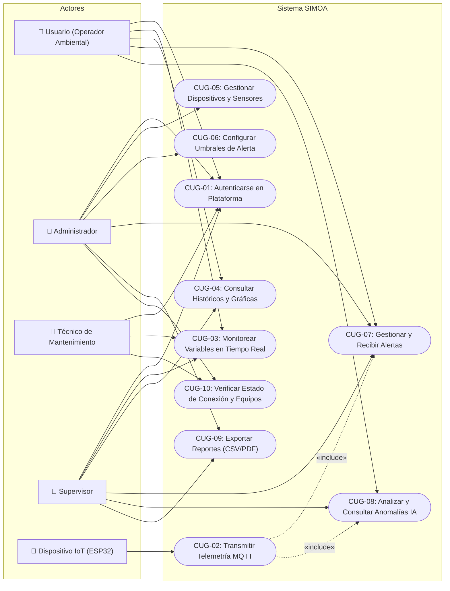

---

#### 3.2.2 Casos de Uso Específicos por Historia de Usuario (CU-01 a CU-13)

En coherencia estricta con la sección **3.5 Historias de Usuario (`HU-01` a `HU-13`)**, existe un caso de uso específico e individual por cada historia de usuario (`HU-01 → CU-01` hasta `HU-13 → CU-13`). Cada caso de uso está vinculado directamente a una funcionalidad del diagrama general (`CUG-01` a `CUG-10`).

---

##### Diagrama 3.2.2.1 — CU-01: Iniciar sesión en plataforma (`HU-01`)

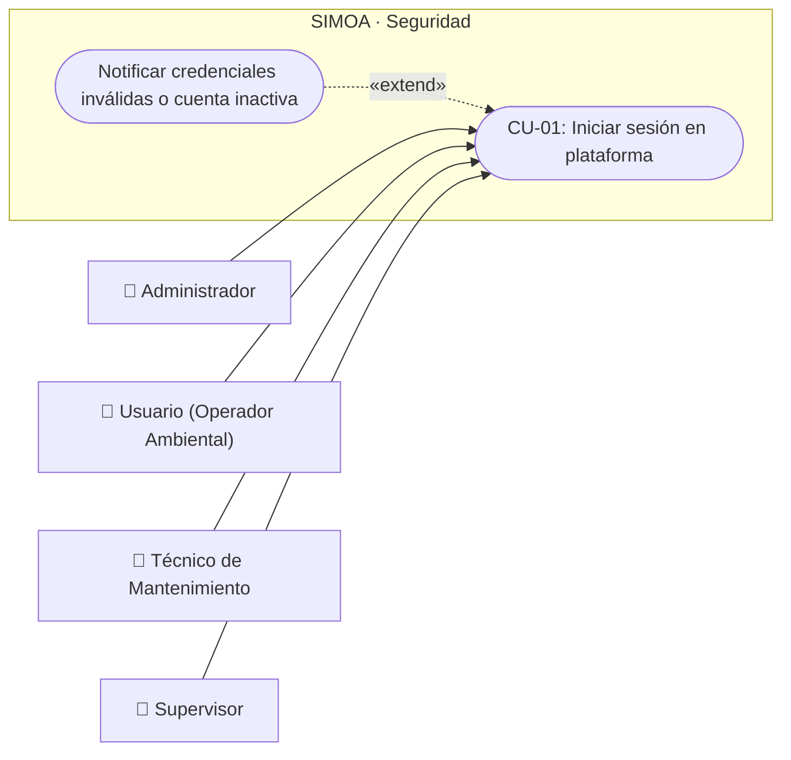

1. **Identificador:** `CU-01`
2. **Nombre del caso de uso:** Iniciar sesión en plataforma.
3. **Historia de usuario relacionada:** `HU-01` (*Como Administrador, quiero iniciar sesión con credenciales seguras para acceder a las opciones de administración de SIMOA*).
4. **Actor principal:** Administrador.
5. **Actores secundarios:** Usuario (Operador Ambiental), Técnico de Mantenimiento, Supervisor (también utilizan el acceso autenticado según su rol).
6. **Objetivo:** Validar las credenciales del usuario y otorgarle acceso seguro a las funcionalidades autorizadas para su perfil mediante un token JWT.
7. **Descripción:** El usuario ingresa su correo electrónico y contraseña en el formulario de inicio de sesión; el backend FastAPI coteja el hash `bcrypt` en MySQL y emite un token JWT firmado.
8. **Precondiciones:** El usuario debe estar registrado y activo en la tabla `usuarios` de la base de datos.
9. **Flujo principal:**
   1. El actor accede a la pantalla de inicio de sesión de SIMOA.
   2. Ingresa su correo electrónico y contraseña y presiona ingresar (`POST /api/auth/login`).
   3. El sistema consulta la base de datos y verifica la contraseña mediante el hash `bcrypt`.
   4. Al confirmar la validez, el sistema genera un token JWT con vigencia de 8 horas y carga el rol correspondiente.
   5. El frontend almacena el token y redirige al actor hacia su panel principal.
10. **Flujos alternativos o excepciones:**
    - *FA-01 (Credenciales incorrectas):* El sistema extiende el flujo para mostrar *"Correo o contraseña incorrectos"* y deniega el acceso.
    - *FA-02 (Cuenta inactiva):* El sistema bloquea el ingreso e indica contactar al Administrador.
11. **Postcondiciones:** Sesión autenticada en el navegador con token Bearer JWT activo y acceso habilitado según el rol.
12. **Relaciones include o extend:** `«extend»` hacia *Notificar credenciales inválidas o cuenta inactiva* ante fallo de validación.

---

##### Diagrama 3.2.2.2 — CU-02: Registrar dispositivo IoT (`HU-02`)

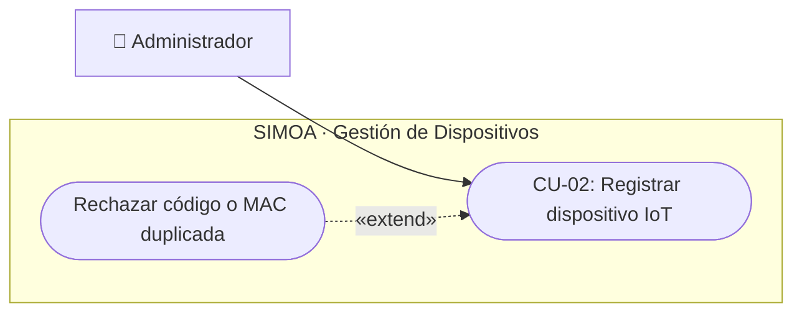

1. **Identificador:** `CU-02`
2. **Nombre del caso de uso:** Registrar dispositivo IoT.
3. **Historia de usuario relacionada:** `HU-02` (*Como Administrador, quiero registrar dispositivos IoT para tener identificados los nodos ESP32 en el sistema*).
4. **Actor principal:** Administrador.
5. **Actores secundarios:** Ninguno.
6. **Objetivo:** Dar de alta un nuevo nodo microcontrolador ESP32 en el inventario del sistema con identificador único y estado inicial activo.
7. **Descripción:** El Administrador diligencia el formulario de registro de dispositivo (`POST /api/dispositivos`) ingresando código único, nombre y dirección MAC para habilitar el nodo en la red SIMOA.
8. **Precondiciones:** El Administrador debe haber iniciado sesión (`CU-01`).
9. **Flujo principal:**
   1. El Administrador ingresa al módulo de Gestión de Dispositivos.
   2. Selecciona la opción para registrar un nuevo dispositivo IoT.
   3. Ingresa los campos obligatorios: código único (ej. `ESP32-LAB01`), nombre descriptivo y dirección MAC.
   4. El sistema valida que el código no exista en la base de datos (RN-01).
   5. El sistema guarda el registro en la tabla `dispositivos` con estado inicial `Activo` y confirma en pantalla.
10. **Flujos alternativos o excepciones:**
    - *FA-01 (Código duplicado o campos vacíos):* El sistema extiende el flujo mostrando un mensaje de error de validación y solicita corregir el código antes de guardar.
11. **Postcondiciones:** Dispositivo IoT almacenado en MySQL y disponible para asociarle sensores y ubicación.
12. **Relaciones include o extend:** `«extend»` hacia *Rechazar código o MAC duplicada* cuando se incumple RN-01.

---

##### Diagrama 3.2.2.3 — CU-03: Asignar ubicación física a dispositivos (`HU-03`)

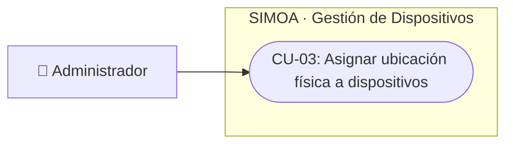

1. **Identificador:** `CU-03`
2. **Nombre del caso de uso:** Asignar ubicación física a dispositivos.
3. **Historia de usuario relacionada:** `HU-03` (*Como Administrador, quiero asignar una ubicación física a cada dispositivo para saber con exactitud en qué aula o laboratorio se efectúan las mediciones*).
4. **Actor principal:** Administrador.
5. **Actores secundarios:** Ninguno.
6. **Objetivo:** Asociar o actualizar la ubicación física (aula, laboratorio, oficina o bodega) de un dispositivo IoT registrado.
7. **Descripción:** El Administrador selecciona un nodo ESP32 existente y define o edita el campo descriptivo de ubicación (`PUT /api/dispositivos/{id}`) para identificar el espacio monitoreado.
8. **Precondiciones:** El Administrador debe haber iniciado sesión (`CU-01`) y el dispositivo debe existir previamente (`CU-02`).
9. **Flujo principal:**
   1. El Administrador ingresa al módulo de Gestión de Dispositivos y selecciona un nodo registrado.
   2. Abre la opción de edición del dispositivo.
   3. Ingresa o modifica el campo de ubicación física (ej. *"Laboratorio 3 - CIES"*).
   4. Guarda los cambios mediante `PUT /api/dispositivos/{id}`.
   5. El sistema actualiza el atributo `ubicacion` en MySQL y muestra el nuevo valor en la tabla.
10. **Flujos alternativos o excepciones:**
    - *FA-01 (Campo de ubicación vacío):* El sistema solicita ingresar una descripción válida antes de confirmar la actualización.
11. **Postcondiciones:** El dispositivo queda vinculado a su ubicación física actualizada en toda la interfaz y reportes.
12. **Relaciones include o extend:** Ninguna.

---

##### Diagrama 3.2.2.4 — CU-04: Asociar sensores DHT22 a dispositivos (`HU-04`)

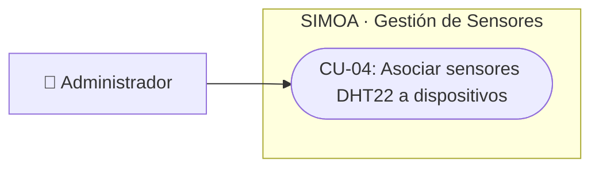

1. **Identificador:** `CU-04`
2. **Nombre del caso de uso:** Asociar sensores DHT22 a dispositivos.
3. **Historia de usuario relacionada:** `HU-04` (*Como Administrador, quiero asociar sensores DHT22 a cada nodo para especificar qué variables ambientales registra*).
4. **Actor principal:** Administrador.
5. **Actores secundarios:** Ninguno.
6. **Objetivo:** Vincular uno o varios sensores digitales (ej. DHT22) a un dispositivo IoT especificando la variable monitoreada y su unidad de medida.
7. **Descripción:** El Administrador registra un sensor (`POST /api/sensores`) asociándolo a un nodo ESP32 y definiendo el tipo de variable (`Temperatura` / `Humedad`), modelo, pin GPIO y unidad (`°C` / `%HR`).
8. **Precondiciones:** El Administrador debe estar autenticado (`CU-01`) y el dispositivo IoT debe estar registrado (`CU-02`).
9. **Flujo principal:**
   1. El Administrador selecciona un dispositivo en el módulo de Gestión de Dispositivos y Sensores.
   2. Selecciona agregar un nuevo sensor al nodo.
   3. Define el tipo de variable (temperatura o humedad), el modelo (`DHT22`), la unidad de medida (`°C` o `%HR`) y el pin GPIO.
   4. Envía el registro al backend (`POST /api/sensores`).
   5. El sistema almacena el sensor en la tabla `sensores` con estado activo.
10. **Flujos alternativos o excepciones:**
    - *FA-01 (Datos incompletos o dispositivo inexistente):* El sistema rechaza la asociación e informa los campos requeridos.
11. **Postcondiciones:** Sensor vinculado al dispositivo y habilitado para recibir mediciones y configurar umbrales.
12. **Relaciones include o extend:** Ninguna.

---

##### Diagrama 3.2.2.5 — CU-05: Visualizar temperatura actual en tiempo real (`HU-05`)

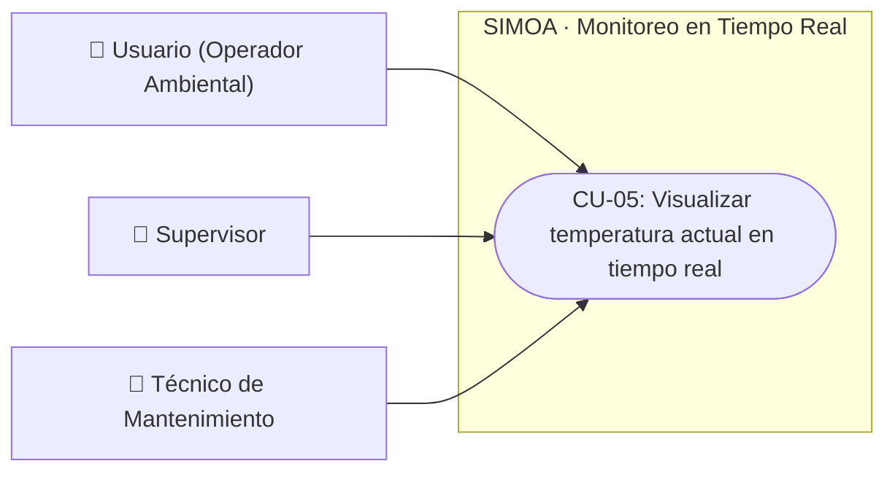

1. **Identificador:** `CU-05`
2. **Nombre del caso de uso:** Visualizar temperatura actual en tiempo real.
3. **Historia de usuario relacionada:** `HU-05` (*Como Operador, quiero visualizar la temperatura actual en tiempo real para verificar el confort térmico inmediato del ambiente*).
4. **Actor principal:** Usuario (Operador Ambiental).
5. **Actores secundarios:** Supervisor, Técnico de Mantenimiento (consultan las lecturas actuales para supervisión u operación técnica).
6. **Objetivo:** Mostrar de forma continua el valor numérico de temperatura actual en grados Celsius (`°C`), su hora de última lectura y su estado visual.
7. **Descripción:** El Dashboard consulta el endpoint `/api/mediciones/actuales` y actualiza dinámicamente la tarjeta KPI y el indicador de temperatura en tiempo real sin recargar la página.
8. **Precondiciones:** El actor debe estar autenticado (`CU-01`) y debe existir al menos un sensor de temperatura con mediciones recibidas vía MQTT.
9. **Flujo principal:**
   1. El actor ingresa al Dashboard principal de monitoreo.
   2. Selecciona el dispositivo o recinto deseado (o visualiza la vista general).
   3. El frontend solicita las últimas mediciones al backend (`GET /api/mediciones/actuales`).
   4. El sistema despliega el valor de temperatura actual en `°C`, la marca temporal de la última actualización y el indicador visual de estado (Normal, Advertencia o Crítico).
   5. El valor se refresca automáticamente conforme llegan nuevas lecturas.
10. **Flujos alternativos o excepciones:**
    - *FA-01 (Sin mediciones recientes):* El panel indica *"Sin lecturas recientes"* o estado desconectado si el nodo no transmite.
11. **Postcondiciones:** El actor visualiza el estado térmico actualizado del ambiente monitoreado.
12. **Relaciones include o extend:** Ninguna.

---

##### Diagrama 3.2.2.6 — CU-06: Visualizar humedad relativa actual en tiempo real (`HU-06`)

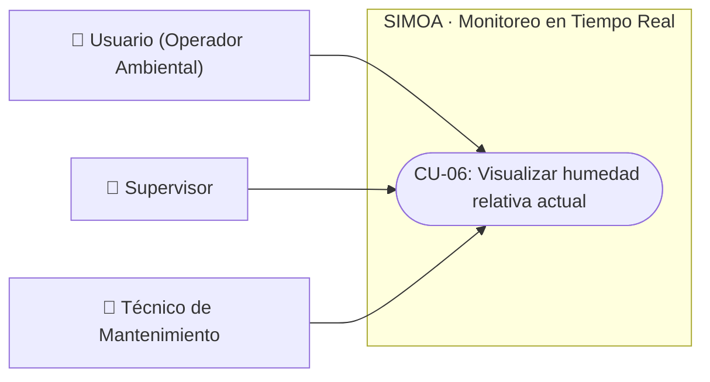

1. **Identificador:** `CU-06`
2. **Nombre del caso de uso:** Visualizar humedad relativa actual en tiempo real.
3. **Historia de usuario relacionada:** `HU-06` (*Como Operador, quiero visualizar la humedad relativa actual para comprobar que los niveles de vapor de agua estén en rangos seguros*).
4. **Actor principal:** Usuario (Operador Ambiental).
5. **Actores secundarios:** Supervisor, Técnico de Mantenimiento.
6. **Objetivo:** Presentar el porcentaje actual de humedad relativa (`%HR`) junto con su código de color según cercanía a los límites configurados.
7. **Descripción:** El Dashboard obtiene el dato más reciente del sensor de humedad desde `/api/mediciones/actuales` y lo muestra en porcentaje (`%HR`) con actualización periódica automática.
8. **Precondiciones:** Actor autenticado (`CU-01`) y sensor de humedad activo con datos almacenados.
9. **Flujo principal:**
   1. El actor accede al Dashboard principal de SIMOA.
   2. Selecciona el ambiente o dispositivo a inspeccionar.
   3. El sistema consulta la última medición de humedad relativa en el backend.
   4. Se muestra el porcentaje (`%HR`) en la tarjeta KPI y cambia el color del indicador según la proximidad a los límites configurados.
   5. La lectura se actualiza automáticamente en pantalla con cada nuevo ciclo de telemetría.
10. **Flujos alternativos o excepciones:**
    - *FA-01 (Lectura fuera de rango físico 0%-100%):* Según RN-02, el sistema descarta la lectura defectuosa del DHT22 y conserva el último estado válido o reporta falla del sensor.
11. **Postcondiciones:** El nivel de humedad relativa queda consultado y reflejado visualmente en el panel.
12. **Relaciones include o extend:** Ninguna.

---

##### Diagrama 3.2.2.7 — CU-07: Consultar historial de mediciones por rango de fechas (`HU-07`)

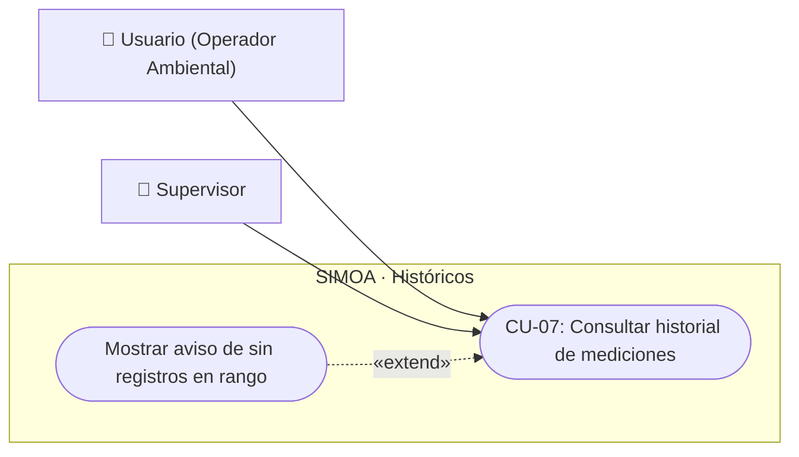

1. **Identificador:** `CU-07`
2. **Nombre del caso de uso:** Consultar historial de mediciones por rango de fechas.
3. **Historia de usuario relacionada:** `HU-07` (*Como Operador, quiero consultar el historial de mediciones por rango de fechas para auditar comportamientos térmicos pasados*).
4. **Actor principal:** Usuario (Operador Ambiental).
5. **Actores secundarios:** Supervisor.
6. **Objetivo:** Permitir la búsqueda, filtrado y revisión paginada de registros históricos de temperatura y humedad entre dos fechas determinadas.
7. **Descripción:** El actor selecciona un dispositivo y un rango de fechas (`desde` y `hasta`); el backend consulta la tabla `mediciones` (`/api/mediciones/historico`) y entrega los registros ordenados en una tabla paginada.
8. **Precondiciones:** El actor debe haber iniciado sesión (`CU-01`) y deben existir mediciones almacenadas.
9. **Flujo principal:**
   1. El actor ingresa al módulo de Históricos.
   2. Selecciona el dispositivo/sensor y define la fecha inicial y la fecha final del periodo.
   3. El sistema envía la consulta (`GET /api/mediciones/historico?desde=...&hasta=...`).
   4. El backend recupera los registros indexados en MySQL ordenados cronológicamente.
   5. La interfaz despliega los datos en tabla con paginación y ordenamiento por columna.
10. **Flujos alternativos o excepciones:**
    - *FA-01 (Sin registros en el rango):* Si la búsqueda no arroja mediciones, se extiende el flujo mostrando un mensaje informativo sin error.
    - *FA-02 (Rango de fechas inválido):* Si la fecha inicial es posterior a la final, el sistema solicita corregir el filtro.
11. **Postcondiciones:** Listado histórico desplegado y listo para auditoría visual.
12. **Relaciones include o extend:** `«extend»` hacia *Mostrar aviso de sin registros en rango* cuando no existen mediciones en el intervalo consultado.

---

##### Diagrama 3.2.2.8 — CU-08: Configurar umbrales mínimos y máximos (`HU-08`)

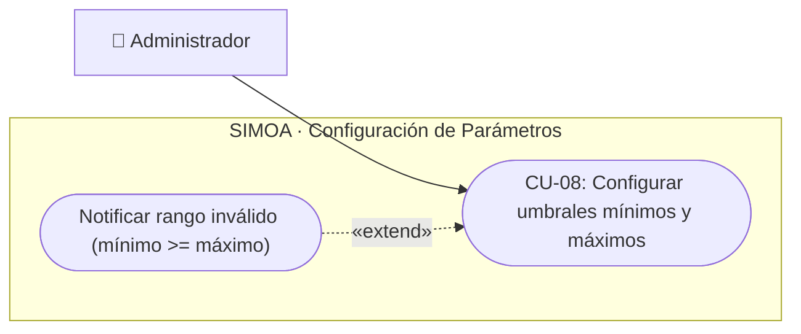

1. **Identificador:** `CU-08`
2. **Nombre del caso de uso:** Configurar umbrales mínimos y máximos.
3. **Historia de usuario relacionada:** `HU-08` (*Como Administrador, quiero configurar umbrales mínimos y máximos para establecer los límites seguros de operación ambiental*).
4. **Actor principal:** Administrador.
5. **Actores secundarios:** Ninguno.
6. **Objetivo:** Definir los límites operativos permisibles (`valor_minimo` y `valor_maximo`) de temperatura y humedad para activar la evaluación automática de alertas.
7. **Descripción:** El Administrador ingresa al módulo de Configuración de Umbrales, ajusta los rangos para un sensor específico y guarda los parámetros (`POST /api/configuraciones`).
8. **Precondiciones:** El Administrador debe haber iniciado sesión (`CU-01`) y el sensor debe estar registrado (`CU-04`).
9. **Flujo principal:**
   1. El Administrador accede al módulo de Configuración de Umbrales.
   2. Selecciona el dispositivo y el sensor a configurar.
   3. Ingresa el valor mínimo y el valor máximo permitido y activa la regla de alerta.
   4. El sistema verifica que `valor_minimo < valor_maximo` y que los valores sean numéricos válidos.
   5. El backend actualiza la tabla `configuraciones` en MySQL y recarga las reglas en memoria de forma inmediata.
10. **Flujos alternativos o excepciones:**
    - *FA-01 (`valor_minimo >= valor_maximo`):* Se extiende el flujo mostrando *"El límite mínimo debe ser estrictamente menor que el límite máximo"* sin guardar cambios.
11. **Postcondiciones:** Nuevos umbrales guardados y aplicados de inmediato sobre las mediciones entrantes.
12. **Relaciones include o extend:** `«extend»` hacia *Notificar rango inválido* si falla la validación de límites.

---

##### Diagrama 3.2.2.9 — CU-09: Recibir alertas visibles en tiempo real (`HU-09`)

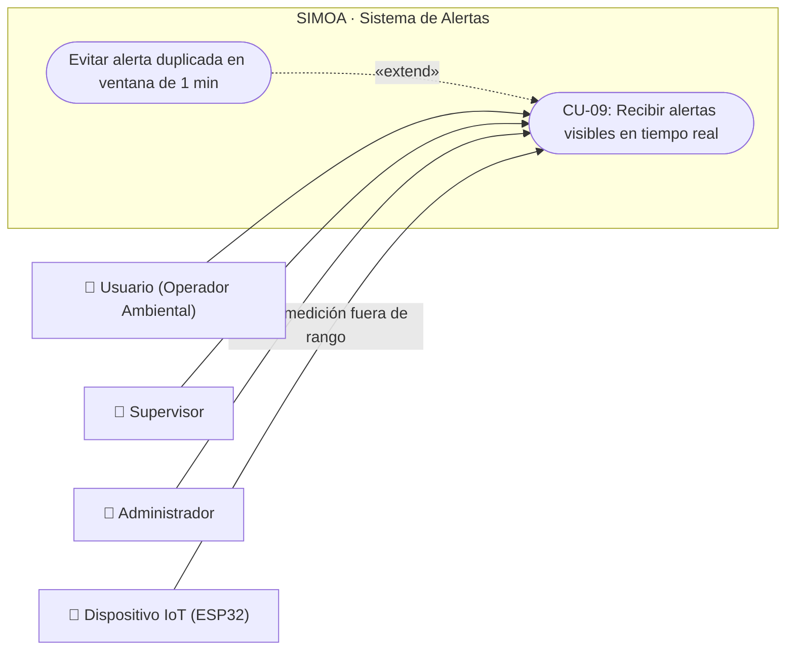

1. **Identificador:** `CU-09`
2. **Nombre del caso de uso:** Recibir alertas visibles en tiempo real.
3. **Historia de usuario relacionada:** `HU-09` (*Como Operador, quiero recibir alertas visibles cuando una variable supere los umbrales para actuar oportunamente ante emergencias*).
4. **Actor principal:** Usuario (Operador Ambiental).
5. **Actores secundarios:** Supervisor, Administrador (reciben y supervisan las alertas), Dispositivo IoT ESP32 (origina la medición que dispara la alerta).
6. **Objetivo:** Detectar cuando una lectura supera el umbral mínimo o máximo y mostrar inmediatamente una alerta visual con el detalle del evento.
7. **Descripción:** El backend compara cada medición entrante contra los umbrales configurados (`CU-08`); ante un desborde, registra el evento en `alertas` y la interfaz web lo muestra como banner/notificación y en la línea de tiempo de alertas.
8. **Precondiciones:** Umbrales activos configurados (`CU-08`), flujo MQTT operativo y usuario autenticado en el Dashboard (`CU-01`).
9. **Flujo principal:**
   1. Llega una nueva medición desde el ESP32 vía MQTT.
   2. El motor de reglas compara el valor contra `valor_minimo` y `valor_maximo`.
   3. Al detectar superación, el sistema crea un registro en la tabla `alertas` con tipo, mensaje, valor detectado, hora y estado `Activa`.
   4. El Dashboard consulta `/api/alertas` y resalta el dispositivo afectado en rojo con campana y banner de alerta en pantalla.
   5. El actor visualiza la notificación e identifica el dispositivo y la magnitud que originó el evento.
10. **Flujos alternativos o excepciones:**
    - *FA-01 (Alerta repetida en menos de 1 minuto):* Según RN-06, se extiende el flujo evitando duplicar alertas si ya existe una alerta activa en la misma franja temporal.
11. **Postcondiciones:** Alerta registrada en MySQL y visible en tiempo real para los operadores y supervisores.
12. **Relaciones include o extend:** `«extend»` hacia *Evitar alerta duplicada en ventana de 1 min* según RN-06.

---

##### Diagrama 3.2.2.10 — CU-10: Consultar estado de conexión de los nodos ESP32 (`HU-10`)

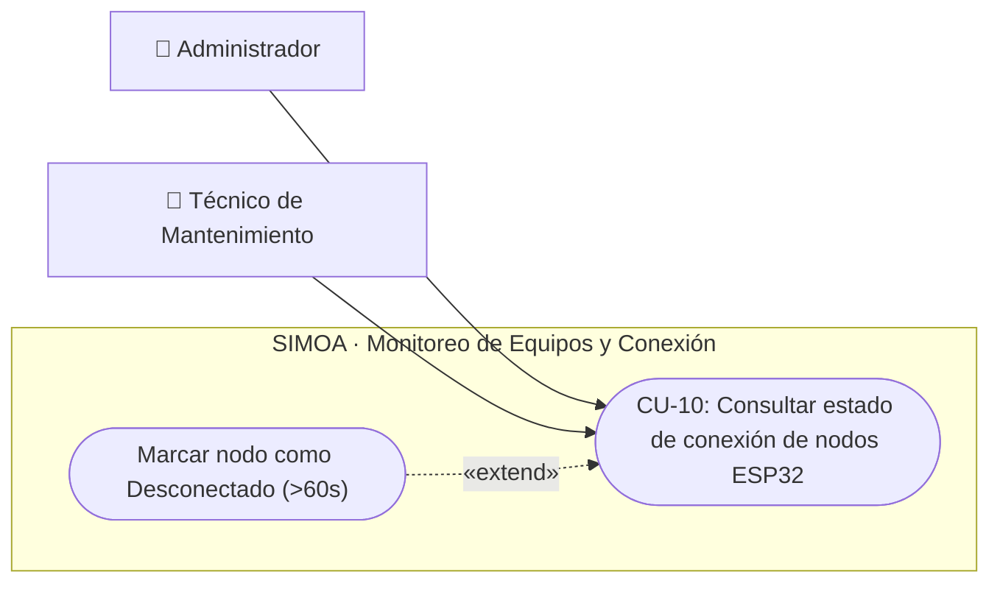

1. **Identificador:** `CU-10`
2. **Nombre del caso de uso:** Consultar estado de conexión de los nodos ESP32.
3. **Historia de usuario relacionada:** `HU-10` (*Como Administrador, quiero ver el estado de conexión de los ESP32 para identificar nodos apagados o con problemas de señal Wi-Fi*).
4. **Actor principal:** Administrador.
5. **Actores secundarios:** Técnico de Mantenimiento (verifica conexiones y atiende fallas de red/equipos según el SRS).
6. **Objetivo:** Permitir visualizar en tiempo real qué nodos ESP32 se encuentran en línea y cuáles han perdido conectividad.
7. **Descripción:** El sistema verifica el timestamp `ultima_conexion` de cada dispositivo registrado y muestra en el panel el indicador visual `En línea` o `Desconectado` (`GET /api/dispositivos`).
8. **Precondiciones:** Actor autenticado (`CU-01`) y nodos ESP32 registrados en el sistema (`CU-02`).
9. **Flujo principal:**
   1. El Administrador o el Técnico de Mantenimiento ingresa al Dashboard o al módulo de Dispositivos.
   2. El sistema consulta la lista de dispositivos y compara `ultima_conexion` contra la hora actual UTC.
   3. Los nodos que emitieron telemetría dentro de los últimos 60 segundos se muestran con indicador verde `EN LÍNEA`.
   4. El actor revisa el estado de cada equipo y su última marca temporal de comunicación.
10. **Flujos alternativos o excepciones:**
    - *FA-01 (Tiempo sin transmisión mayor a 60 segundos):* Según RN-03, se extiende el flujo cambiando automáticamente el estado del nodo a `DESCONECTADO` (gris/rojo) para alertar sobre posible caída Wi-Fi o apagado.
11. **Postcondiciones:** Estado de conectividad de todos los nodos visible y actualizado para diagnóstico o mantenimiento.
12. **Relaciones include o extend:** `«extend»` hacia *Marcar nodo como Desconectado (>60s)* cuando se cumple la regla RN-03.

---

##### Diagrama 3.2.2.11 — CU-11: Visualizar gráficos de líneas dinámicos (`HU-11`)

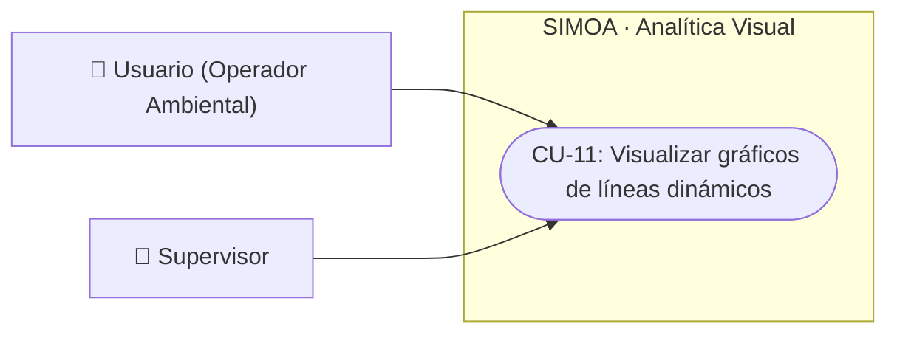

1. **Identificador:** `CU-11`
2. **Nombre del caso de uso:** Visualizar gráficos de líneas dinámicos.
3. **Historia de usuario relacionada:** `HU-11` (*Como Operador, quiero ver gráficos de líneas dinámicos para analizar visualmente la tendencia de temperatura y humedad en el tiempo*).
4. **Actor principal:** Usuario (Operador Ambiental).
5. **Actores secundarios:** Supervisor.
6. **Objetivo:** Graficar de forma interactiva la evolución temporal de temperatura y humedad relativa para facilitar la interpretación de tendencias.
7. **Descripción:** La interfaz web construye gráficas de líneas dinámicas mediante Chart.js con ejes diferenciados por color y tooltips interactivos al pasar el cursor sobre cada punto.
8. **Precondiciones:** Actor autenticado (`CU-01`) y existencia de series temporales para el dispositivo seleccionado.
9. **Flujo principal:**
   1. El actor accede al Dashboard o al módulo de Analítica.
   2. Selecciona el dispositivo y la ventana temporal deseada.
   3. El frontend recupera la serie de mediciones desde el backend.
   4. Renderiza la gráfica de líneas diferenciando temperatura y humedad con colores distintos.
   5. El actor interactúa con los puntos de la curva para inspeccionar valores exactos y marcas de tiempo en el tooltip.
10. **Flujos alternativos o excepciones:**
    - *FA-01 (Sin datos suficientes para trazar curva):* El lienzo de la gráfica muestra un estado vacío informativo sin bloquear la interfaz.
11. **Postcondiciones:** Tendencia ambiental graficada e interactiva en pantalla.
12. **Relaciones include o extend:** Ninguna.

---

##### Diagrama 3.2.2.12 — CU-12: Exportar mediciones a archivo CSV (`HU-12`)

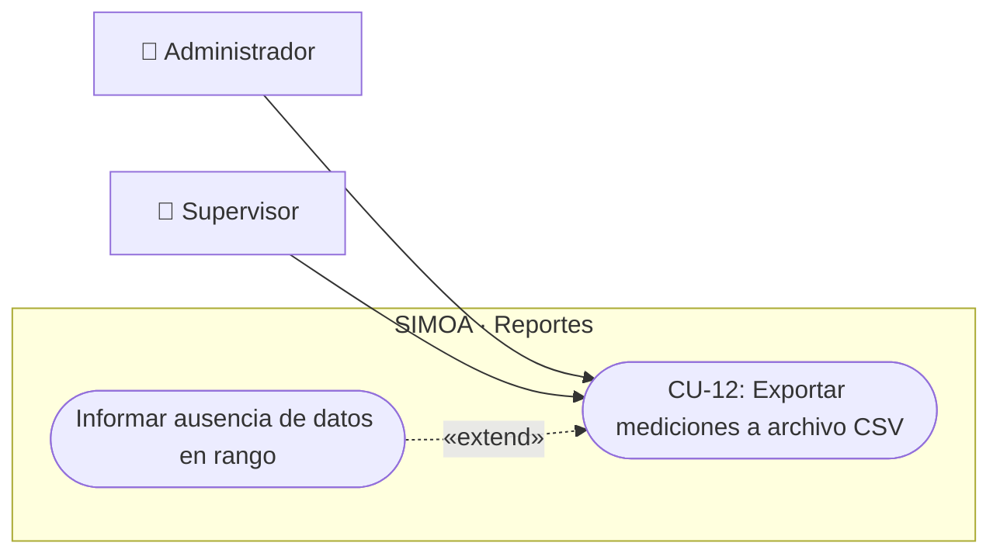

1. **Identificador:** `CU-12`
2. **Nombre del caso de uso:** Exportar mediciones a archivo CSV.
3. **Historia de usuario relacionada:** `HU-12` (*Como Administrador, quiero exportar las mediciones a un archivo CSV para analizarlas en herramientas externas como Excel o Python*).
4. **Actor principal:** Administrador.
5. **Actores secundarios:** Supervisor (exporta reportes consolidados según sus responsabilidades en el sistema).
6. **Objetivo:** Generar y descargar un archivo tabular `.csv` con los registros de mediciones filtrados por fecha para análisis externo o auditoría.
7. **Descripción:** El actor selecciona los parámetros de fecha en el módulo de Reportes; el backend (`/api/reportes/exportar`) consulta MySQL y genera un archivo CSV con encabezados `id, dispositivo, sensor, variable, valor, fecha_hora`.
8. **Precondiciones:** Actor autenticado (`CU-01`) y existencia de registros históricos en el rango seleccionado.
9. **Flujo principal:**
   1. El actor ingresa al módulo de Reportes.
   2. Selecciona el rango de fechas y opcionalmente el dispositivo a exportar.
   3. Presiona exportar CSV (`GET /api/reportes/exportar?formato=csv&desde=...`).
   4. El backend consulta las mediciones en MySQL y construye el archivo tabular con encabezados limpios.
   5. El navegador descarga el archivo `.csv` directamente en el equipo del actor.
10. **Flujos alternativos o excepciones:**
    - *FA-01 (Sin registros en el rango elegido):* Se extiende el flujo notificando al actor que no existen datos para exportar en ese periodo.
11. **Postcondiciones:** Archivo `.csv` descargado y disponible para su apertura en Excel o herramientas de análisis.
12. **Relaciones include o extend:** `«extend»` hacia *Informar ausencia de datos en rango* cuando el resultado de la consulta está vacío.

---

##### Diagrama 3.2.2.13 — CU-13: Visualizar anomalías detectadas por IA (`HU-13`)

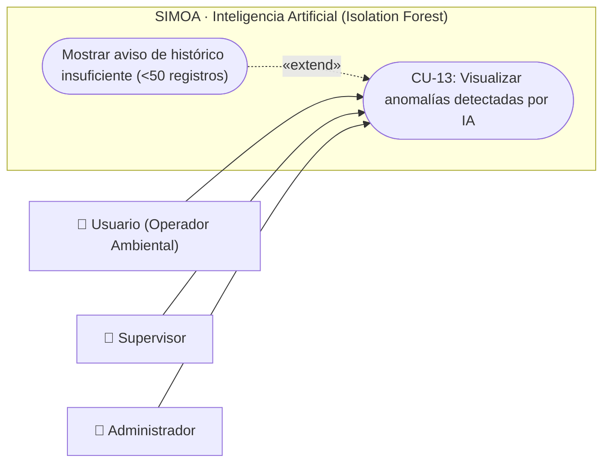

1. **Identificador:** `CU-13`
2. **Nombre del caso de uso:** Visualizar anomalías detectadas por IA.
3. **Historia de usuario relacionada:** `HU-13` (*Como Operador, quiero visualizar las anomalías marcadas por el modelo de IA para investigar comportamientos atípicos no detectados por los umbrales comunes*).
4. **Actor principal:** Usuario (Operador Ambiental).
5. **Actores secundarios:** Supervisor, Administrador.
6. **Objetivo:** Consultar las mediciones clasificadas como estadísticamente atípicas por el algoritmo *Isolation Forest* junto con su puntaje de anomalía y representación visual diferenciada.
7. **Descripción:** El módulo de IA en Python ejecuta *Isolation Forest* en segundo plano marcando `es_anomalia_ia = true` y `score_anomalia`; el frontend consulta `/api/ia/anomalias` para resaltar dichos puntos en color distintivo y mostrar su listado.
8. **Precondiciones:** Actor autenticado (`CU-01`) y existencia de al menos 50 mediciones registradas para que el modelo realice inferencia.
9. **Flujo principal:**
   1. El actor ingresa al módulo de Análisis Inteligente de Anomalías.
   2. El frontend consulta el endpoint `GET /api/ia/anomalias`.
   3. El sistema retorna los registros etiquetados por *Isolation Forest* con su `score_anomalia` y marca de tiempo.
   4. La interfaz grafica los puntos anómalos en color distintivo (ámbar/púrpura) sobre la serie temporal y despliega el listado detallado.
   5. El actor revisa los eventos atípicos para investigar posibles fallas incipientes de sensor o climatización.
10. **Flujos alternativos o excepciones:**
    - *FA-01 (Dataset menor a 50 registros):* Se extiende el flujo indicando que el modelo está recopilando histórico suficiente para iniciar la detección sin mostrar errores.
11. **Postcondiciones:** Anomalías identificadas por IA consultadas y auditadas visualmente en el panel.
12. **Relaciones include o extend:** `«extend»` hacia *Mostrar aviso de histórico insuficiente (<50 registros)* cuando no se alcanza el mínimo de muestras.

---

#### 3.2.3 Tabla de Trazabilidad (Historias de Usuario, Actores y Casos de Uso)

| Historia de usuario | Actor | Caso de uso | Caso de uso general relacionado |
| :--- | :--- | :--- | :--- |
| **HU-01:** Iniciar sesión con credenciales seguras | Administrador (y roles autorizados: Usuario, Técnico, Supervisor) | **CU-01:** Iniciar sesión en plataforma | **CUG-01:** Autenticarse en Plataforma |
| **HU-02:** Registrar dispositivos IoT | Administrador | **CU-02:** Registrar dispositivo IoT | **CUG-05:** Gestionar Dispositivos y Sensores |
| **HU-03:** Asignar ubicación física a dispositivos | Administrador | **CU-03:** Asignar ubicación física a dispositivos | **CUG-05:** Gestionar Dispositivos y Sensores |
| **HU-04:** Asociar sensores DHT22 a cada nodo | Administrador | **CU-04:** Asociar sensores DHT22 a dispositivos | **CUG-05:** Gestionar Dispositivos y Sensores |
| **HU-05:** Visualizar temperatura actual en tiempo real | Usuario (Operador Ambiental) / Supervisor / Técnico | **CU-05:** Visualizar temperatura actual en tiempo real | **CUG-03:** Monitorear Variables en Tiempo Real |
| **HU-06:** Visualizar humedad relativa actual | Usuario (Operador Ambiental) / Supervisor / Técnico | **CU-06:** Visualizar humedad relativa actual en tiempo real | **CUG-03:** Monitorear Variables en Tiempo Real |
| **HU-07:** Consultar historial de mediciones por rango de fechas | Usuario (Operador Ambiental) / Supervisor | **CU-07:** Consultar historial de mediciones por rango de fechas | **CUG-04:** Consultar Históricos y Gráficas |
| **HU-08:** Configurar umbrales mínimos y máximos | Administrador | **CU-08:** Configurar umbrales mínimos y máximos | **CUG-06:** Configurar Umbrales de Alerta |
| **HU-09:** Recibir alertas visibles en tiempo real | Usuario (Operador Ambiental) / Supervisor / Administrador | **CU-09:** Recibir alertas visibles en tiempo real | **CUG-07:** Gestionar y Recibir Alertas |
| **HU-10:** Consultar estado de conexión de los nodos ESP32 | Administrador / Técnico de Mantenimiento | **CU-10:** Consultar estado de conexión de los nodos ESP32 | **CUG-10:** Verificar Estado de Conexión y Equipos |
| **HU-11:** Visualizar gráficos de líneas dinámicos | Usuario (Operador Ambiental) / Supervisor | **CU-11:** Visualizar gráficos de líneas dinámicos | **CUG-04:** Consultar Históricos y Gráficas |
| **HU-12:** Exportar mediciones a archivo CSV | Administrador / Supervisor | **CU-12:** Exportar mediciones a archivo CSV | **CUG-09:** Exportar Reportes (CSV/PDF) |
| **HU-13:** Visualizar anomalías detectadas por IA | Usuario (Operador Ambiental) / Supervisor / Administrador | **CU-13:** Visualizar anomalías detectadas por IA | **CUG-08:** Analizar y Consultar Anomalías IA |

---

### 3.3 Catálogo y Fichas Técnicas de Requerimientos Funcionales

| Código | Requisito Funcional | Prioridad | Módulo |
| :--- | :--- | :--- | :--- |
| **RF-01** | Autenticación y Control de Acceso por Roles (JWT) | Alta | Seguridad |
| **RF-02** | Registro y Administración de Dispositivos IoT | Alta | Dispositivos |
| **RF-03** | Asignación de Nombres, Códigos y Ubicaciones Físicas | Media | Dispositivos |
| **RF-04** | Registro y Vinculación de Sensores DHT22 | Alta | Sensores |
| **RF-05** | Configuración de Magnitudes y Variables Monitoreadas | Media | Sensores |
| **RF-06** | Ingestión y Recepción Continua de Telemetría por MQTT | Alta | Comunicaciones |
| **RF-07** | Almacenamiento Persistente de Mediciones en Base de Datos | Alta | Persistencia |
| **RF-08** | Visualización en Tiempo Real de la Temperatura Actual (°C) | Alta | Dashboard |
| **RF-09** | Visualización en Tiempo Real de la Humedad Relativa (%HR) | Alta | Dashboard |
| **RF-10** | Consulta y Filtrado Histórico de Mediciones | Alta | Históricos |
| **RF-11** | Generación de Gráficos de Tendencia Dinámicos | Alta | Analítica |
| **RF-12** | Configuración de Umbrales Mínimos y Máximos de Alerta | Alta | Alertas |
| **RF-13** | Detección Automática y Emisión de Alertas por Desborde | Alta | Alertas |
| **RF-14** | Bitácora y Registro Histórico de Eventos de Alerta | Media | Alertas |
| **RF-15** | Detección de Caídas de Red y Dispositivos Desconectados | Media | Monitoreo |
| **RF-16** | Generación y Descarga de Reportes Ambientales | Media | Reportes |
| **RF-17** | Exportación de Datos en Formato Tabular CSV | Media | Reportes |
| **RF-18** | Detección de Anomalías Estadísticas mediante IA (Isolation Forest) | Alta | Inteligencia Artificial |
| **RF-19** | Monitoreo y Marcación Visual del Estado de Conexión | Alta | Dashboard |
| **RF-20** | Ficha Técnica Detallada e Historial por Dispositivo | Media | Dispositivos |

---

#### Fichas Técnicas Detalladas de Requerimientos Funcionales

##### Ficha RF-01: Autenticación y Control de Acceso por Roles
| Campo | Especificación |
| :--- | :--- |
| **Identificador:** | **RF-01** |
| **Nombre:** | Inicio de Sesión y Autenticación Segura |
| **Tipo:** | Necesario |
| **¿Crítico?:** | Sí |
| **Prioridad:** | Alta |
| **Requerimientos asociados:** | RF-02, RF-05, RF-12, RF-13 |
| **Descripción:** | El sistema debe validar la identidad del usuario mediante correo electrónico y contraseña encriptada, generando un Token JWT firmado que delimita sus privilegios según el rol asignado (Administrador u Operador). |
| **Entradas:** | Correo electrónico, Contraseña en texto plano. |
| **Salidas:** | Token JWT de acceso, datos del perfil (nombre, rol), mensaje de confirmación o error de autenticación. |
| **Flujo Principal:** | 1. El usuario accede a la pantalla de Login e ingresa credenciales.<br>2. El sistema consulta la base de datos y compara el hash bcrypt.<br>3. Al autenticar con éxito, se genera el JWT con vigencia de 8 horas.<br>4. El frontend almacena el token y redirige al Dashboard correspondiente. |
| **Manejo Anormal:** | - Credenciales erróneas: Mostrar *"Correo o contraseña incorrectos"*; denegar acceso.<br>- Usuario inactivo: Mostrar *"Cuenta deshabilitada. Contacte al administrador"*. |
| **Reglas de Negocio:** | RN-01: Contraseñas con longitud mínima de 8 caracteres.<br>RN-02: Acceso protegido por token Bearer en todas las rutas privadas. |
| **Criterios de Aceptación:** | 1. Usuario registrado accede en menos de 1 segundo.<br>2. Credenciales inválidas no exponen detalles internos.<br>3. Redirección automática según rol. |

##### Ficha RF-06: Ingestión de Mediciones vía MQTT
| Campo | Especificación |
| :--- | :--- |
| **Identificador:** | **RF-06** |
| **Nombre:** | Ingestión y Recepción Continua de Telemetría por MQTT |
| **Tipo:** | Necesario |
| **¿Crítico?:** | Sí |
| **Prioridad:** | Alta |
| **Requerimientos asociados:** | RF-07, RF-08, RF-09, RF-13, RF-15 |
| **Descripción:** | El sistema debe suscribirse a los tópicos MQTT designados (`simoa/dispositivos/+/telemetria`) en el broker Mosquitto para recibir paquetes de telemetría emitidos por los nodos ESP32. |
| **Entradas:** | Mensaje MQTT en formato JSON conteniendo: `{ "codigo": "ESP32-01", "temperatura": 24.5, "humedad": 65.2, "timestamp": 1794575000 }`. |
| **Salidas:** | Mensaje recibido en el backend, validado y enrutado hacia el hilo de persistencia y al motor de reglas. |
| **Flujo Principal:** | 1. El ESP32 toma lecturas del DHT22 y publica el JSON en el broker.<br>2. El cliente MQTT del backend captura el mensaje publicado.<br>3. Se comprueba que el código del dispositivo exista en la base de datos.<br>4. Se despachan los valores a almacenamiento (RF-07) y evaluación de alertas (RF-13). |
| **Manejo Anormal:** | - Payload JSON malformado: Registrar en log de errores y descartar paquete.<br>- Dispositivo no reconocido: Registrar evento de nodo no autorizado. |
| **Reglas de Negocio:** | RN-03: Solo procesar paquetes de dispositivos activos.<br>RN-04: Intervalo nominal de recepción: 5 segundos. |
| **Criterios de Aceptación:** | 1. El broker recibe y despacha paquetes sin pérdidas a 1 msg/seg por nodo.<br>2. El backend procesa el payload en menos de 100 ms. |

##### Ficha RF-12: Configuración de Umbrales Ambientales
| Campo | Especificación |
| :--- | :--- |
| **Identificador:** | **RF-12** |
| **Nombre:** | Configuración de Límites y Umbrales Ambientales |
| **Tipo:** | Necesario |
| **¿Crítico?:** | Sí |
| **Prioridad:** | Alta |
| **Requerimientos asociados:** | RF-05, RF-13, RF-14 |
| **Descripción:** | El sistema debe permitir al Administrador definir rangos permitidos (temperatura mínima/máxima y humedad mínima/máxima) para cada sensor o ambiente monitoreado. |
| **Entradas:** | ID del sensor, `valor_minimo`, `valor_maximo`, estado activo/inactivo. |
| **Salidas:** | Registro de configuración actualizado, mensaje de confirmación en la UI. |
| **Flujo Principal:** | 1. El administrador ingresa al módulo de Configuración Ambiental.<br>2. Selecciona el sensor o dispositivo.<br>3. Ajusta los valores umbrales (ej. Min: 18°C, Max: 27°C; Humedad: 40% a 70%).<br>4. El sistema valida que el mínimo sea menor que el máximo.<br>5. Se actualiza la base de datos y se recarga el motor de reglas en memoria. |
| **Manejo Anormal:** | - `valor_minimo >= valor_maximo`: Mostrar mensaje *"El límite mínimo debe ser estrictamente menor que el límite máximo"*. |
| **Reglas de Negocio:** | RN-05: Los umbrales no pueden contener valores nulos ni negativos fuera de escala. |
| **Criterios de Aceptación:** | 1. Cambios de umbral entran en efecto inmediato para las siguientes mediciones. |

##### Ficha RF-13: Detección y Generación Automática de Alertas
| Campo | Especificación |
| :--- | :--- |
| **Identificador:** | **RF-13** |
| **Nombre:** | Generación Automática de Alertas por Desborde de Límites |
| **Tipo:** | Necesario |
| **¿Crítico?:** | Sí |
| **Prioridad:** | Alta |
| **Requerimientos asociados:** | RF-06, RF-08, RF-09, RF-12, RF-14 |
| **Descripción:** | Cada vez que entra una medición, el sistema compara el valor medido contra la configuración activa. Si supera los límites máximos o cae de los mínimos, se genera una alerta inmediata. |
| **Entradas:** | Medición entrante (temperatura o humedad), umbrales activos del sensor. |
| **Salidas:** | Inserción en la tabla `alertas`, emisión de notificación visual en el Dashboard (banner/toasts rojo). |
| **Flujo Principal:** | 1. Entra una medición (ej. 32.5 °C).<br>2. Se evalúa contra el límite máximo configurado (28.0 °C).<br>3. Al detectarse superación, se crea el registro con tipo *"CRÍTICA"*, estado *"ACTIVA"* y mensaje descriptivo.<br>4. El Dashboard resalta el dispositivo en color rojo con un indicador de campana. |
| **Manejo Anormal:** | - Error de base de datos al guardar alerta: Registrar en log del sistema y emitir por socket de emergencia. |
| **Reglas de Negocio:** | RN-06: Prevenir alertas duplicadas si el estado ya está activo en la misma franja de 1 minuto. |
| **Criterios de Aceptación:** | 1. La alerta se crea y se refleja en el frontend en menos de 2 segundos desde el arribo del paquete MQTT. |

##### Ficha RF-18: Detección de Anomalías por Machine Learning (IA)
| Campo | Especificación |
| :--- | :--- |
| **Identificador:** | **RF-18** |
| **Nombre:** | Detección de Anomalías mediante Algoritmo Isolation Forest |
| **Tipo:** | Innovador / Necesario |
| **¿Crítico?:** | No (funciona en complemento a las alertas por umbrales) |
| **Prioridad:** | Alta |
| **Requerimientos asociados:** | RF-07, RF-10, RF-11, RF-14 |
| **Descripción:** | Un proceso periódico en segundo plano entrena y aplica un modelo *Isolation Forest* sobre las series de tiempo de temperatura y humedad para descubrir comportamientos estadísticamente atípicos (pérdida súbita de correlación, microoscilaciones extrañas). |
| **Entradas:** | Dataset de las últimas $N$ mediciones (temperatura, humedad, delta temporal). |
| **Salidas:** | Marcación de registros con etiqueta `es_anomalia = true`, score de anomalía, visualización diferenciada en gráficos (puntos de color ámbar). |
| **Flujo Principal:** | 1. El servicio de IA consulta las mediciones de la última ventana temporal.<br>2. Normaliza los datos e infiere predicciones con el modelo entrenado.<br>3. Las muestras etiquetadas con $-1$ (anomalías) se almacenan con su índice de severidad.<br>4. El Dashboard ofrece una vista especializada para auditar las anomalías detectadas. |
| **Manejo Anormal:** | - Dataset insuficiente (< 50 registros): Suspender predicción hasta acumular histórico representativo sin arrojar error al usuario. |
| **Reglas de Negocio:** | RN-07: El modelo no bloquea las alertas por umbral fijo; ambas capas operan en paralelo. |
| **Criterios de Aceptación:** | 1. Identificación precisa de caídas o picos instantáneos que simulen fallas de sensor o ventilación.<br>2. Tiempo de inferencia inferior a 500 ms por lote. |

---

### 3.4 Catálogo y Fichas de Requerimientos No Funcionales

```
RNF-01: Usabilidad y Diseño Responsive (Mobile/Desktop)
RNF-02: Tiempo de Respuesta de la API (≤ 200 ms)
RNF-03: Eficiencia en Comunicación MQTT (QoS 0/1 bajo ancho de banda)
RNF-04: Seguridad y Cifrado de Contraseñas (Bcrypt / Argon2)
RNF-05: Control de Acceso por Tokens JWT
RNF-06: Rendimiento y Concurrencia (≥ 50 clientes simultáneos)
RNF-07: Integridad y Consistencia Transaccional (ACID en MySQL)
RNF-08: Modularidad y Clean Code en Python (PEP 8 / Estructura por capas)
RNF-09: Seguridad en Broker MQTT (ACLs y credenciales)
RNF-10: Mantenibilidad y Documentación OpenAPI (Swagger)
RNF-11: Tolerancia a Fallos y Copias de Respaldo (Scripts dump MySQL)
RNF-12: Precisión Temporal y Sincronización (NTP / Timestamps UTC)
```

##### Ficha RNF-01: Usabilidad y Diseño Responsive
| Atributo | Detalle |
| :--- | :--- |
| **Identificador:** | **RNF-01** |
| **Nombre:** | Interfaz Intuitiva y Diseño Adaptable |
| **Descripción:** | La aplicación web debe ofrecer una experiencia de usuario fluida, limpia y adaptada a dispositivos móviles, tabletas y computadores personales. |
| **Métrica:** | El 90% de los operadores no técnicos deben poder consultar la temperatura de un salón en menos de 10 segundos desde su acceso. Puntuación Lighthouse de accesibilidad ≥ 85. |
| **Reglas de Negocio:** | Diseño con Tailwind CSS y componentes visuales autoexplicativos. |

##### Ficha RNF-02: Tiempo de Respuesta de la API REST
| Atributo | Detalle |
| :--- | :--- |
| **Identificador:** | **RNF-02** |
| **Nombre:** | Rendimiento en Consultas Habituales |
| **Descripción:** | Los endpoints de consulta de mediciones, alertas y dispositivos deben responder con latencias mínimas para no congelar la interfaz. |
| **Métrica:** | Tiempo de respuesta $\le 200\text{ ms}$ en el 95% de las solicitudes HTTP para consultas ordinarias de mediciones recientes. |
| **Reglas de Negocio:** | Indexación de llaves foráneas y campos temporales en MySQL. |

##### Ficha RNF-04: Seguridad de Credenciales y Cifrado
| Atributo | Detalle |
| :--- | :--- |
| **Identificador:** | **RNF-04** |
| **Nombre:** | Almacenamiento Seguro de Contraseñas |
| **Descripción:** | Ninguna contraseña debe almacenarse en texto claro bajo ninguna circunstancia. |
| **Métrica:** | Empleo estricto de algoritmo de hashing robusto (`bcrypt` con salt factor $\ge 12$). |
| **Reglas de Negocio:** | Imposibilidad de reversión directa; validación exclusiva por cotejo de hashes. |

##### Ficha RNF-06: Rendimiento del Módulo de Inteligencia Artificial
| Atributo | Detalle |
| :--- | :--- |
| **Identificador:** | **RNF-06** |
| **Nombre:** | Eficiencia Computacional en Detección de Anomalías |
| **Descripción:** | El procesamiento de algoritmos de Machine Learning no debe comprometer la disponibilidad del servidor de aplicaciones. |
| **Métrica:** | El reentrenamiento o ejecución por lotes de *Isolation Forest* no debe superar el 30% del uso de CPU por más de 3 segundos consecutivos. |

---

### 3.5 Historias de Usuario (HU-01 a HU-13)

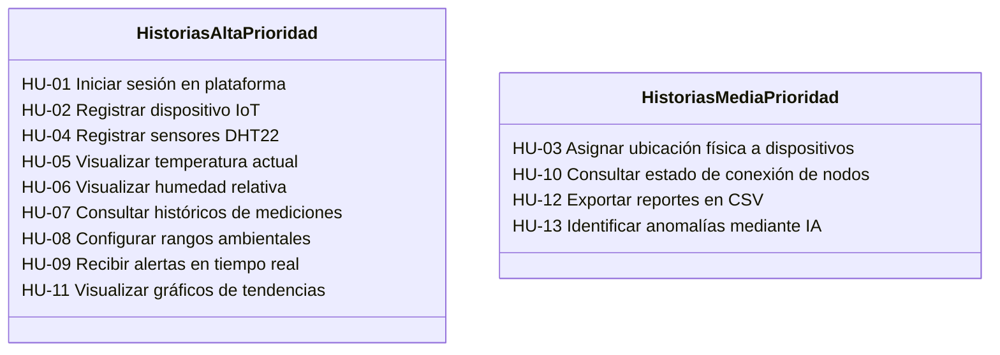

#### Detalle de Historias de Usuario

- **HU-01 (Alta):** *Como Administrador*, quiero iniciar sesión con credenciales seguras *para* acceder a las opciones de administración de SIMOA.  
  - *Criterios:* Acceso concedido ante email/password válidos; entrega de token JWT; denegación ante credenciales incorrectas.
- **HU-02 (Alta):** *Como Administrador*, quiero registrar dispositivos IoT *para* tener identificados los nodos ESP32 en el sistema.  
  - *Criterios:* Código de dispositivo único; validación de campos obligatorios; estado inicial *"Activo"*.
- **HU-03 (Media):** *Como Administrador*, quiero asignar una ubicación física a cada dispositivo *para* saber con exactitud en qué aula o laboratorio se efectúan las mediciones.  
  - *Criterios:* Campo de texto descriptivo (ej. "Laboratorio 3 - CIES"); editable en cualquier momento.
- **HU-04 (Alta):** *Como Administrador*, quiero asociar sensores DHT22 a cada nodo *para* especificar qué variables ambientales registra.  
  - *Criterios:* Definición de magnitud (temperatura/humedad), modelo del sensor, unidad de medida (°C, %HR).
- **HU-05 (Alta):** *Como Operador*, quiero visualizar la temperatura actual en tiempo real *para* verificar el confort térmico inmediato del ambiente.  
  - *Criterios:* Indicación numérica en °C, timestamp de última actualización, indicador visual de estado.
- **HU-06 (Alta):** *Como Operador*, quiero visualizar la humedad relativa actual *para* comprobar que los niveles de vapor de agua estén en rangos seguros.  
  - *Criterios:* Indicación en porcentaje (%HR), cambio de color según proximidad a límites.
- **HU-07 (Alta):** *Como Operador*, quiero consultar el historial de mediciones por rango de fechas *para* auditar comportamientos térmicos pasados.  
  - *Criterios:* Filtro por fecha inicial y final, tabla con paginación, opción de ordenamiento ascendente/descendente.
- **HU-08 (Alta):** *Como Administrador*, quiero configurar umbrales mínimos y máximos *para* establecer los límites seguros de operación ambiental.  
  - *Criterios:* Validación de `min < max`, persistencia inmediata, efecto reactivo en el analizador de telemetría.
- **HU-09 (Alta):** *Como Operador*, quiero recibir alertas visibles cuando una variable supere los umbrales *para* actuar oportunamente ante emergencias.  
  - *Criterios:* Notificación tipo banner/alerta visual en pantalla, registro del evento con hora, dispositivo y valor detectado.
- **HU-10 (Media):** *Como Administrador*, quiero ver el estado de conexión de los ESP32 *para* identificar nodos apagados o con problemas de señal Wi-Fi.  
  - *Criterios:* Si un nodo no transmite en más de 60 segundos, se marca visualmente como *"Desconectado"*.
- **HU-11 (Alta):** *Como Operador*, quiero ver gráficos de líneas dinámicos *para* analizar visualmente la tendencia de temperatura y humedad en el tiempo.  
  - *Criterios:* Curvas claras mediante Chart.js, diferenciación por color, tooltip interactivo con valores puntuales.
- **HU-12 (Media):** *Como Administrador*, quiero exportar las mediciones a un archivo CSV *para* analizarlas en herramientas externas como Excel o Python.  
  - *Criterios:* Descarga directa en navegador con encabezados limpios: `id, dispositivo, sensor, variable, valor, fecha_hora`.
- **HU-13 (Media):** *Como Operador*, quiero visualizar las anomalías marcadas por el modelo de IA *para* investigar comportamientos atípicos no detectados por los umbrales comunes.  
  - *Criterios:* Destacado visual en las gráficas con puntos de color distintivo; listado de anomalías con su puntaje de atipicidad.

---

### 3.6 Reglas de Negocio Consolidadas

- **RN-01 (Unicidad de Identificadores):** El código asignado a cada ESP32 (ej. `ESP32-LAB01`) y el correo de cada usuario deben ser estrictamente únicos en la base de datos.
- **RN-02 (Validación de Lecturas Ambientales):** Cualquier valor de temperatura inferior a $-10\text{ }^\circ\text{C}$ o superior a $60\text{ }^\circ\text{C}$, y de humedad inferior al $0\%$ o superior al $100\%$ se considerará lectura física defectuosa (falla en DHT22) y se marcará como error de hardware sin disparar alertas de evacuación.
- **RN-03 (Caducidad de Conexión - Keep-Alive):** Si el servidor no recibe paquetes de un dispositivo en un lapso mayor a 3 ciclos nominales (60 segundos), su estado cambiará automáticamente de `EN LÍNEA` a `DESCONECTADO`.
- **RN-04 (Inmutabilidad Histórica):** Las mediciones registradas en la tabla `mediciones` no podrán ser editadas ni eliminadas individualmente por ningún usuario para preservar la integridad de la auditoría.
- **RN-05 (Complementariedad de Alertas e IA):** Una alerta por umbral fijo tiene prioridad crítica; el módulo de IA genera advertencias de comportamiento anómalo que complementan el diagnóstico pero no anulan la alarma por temperatura extrema.

---

### 3.7 Requisitos del Sistema de Inteligencia Artificial

- **Algoritmo seleccionado:** *Isolation Forest* (Bosques de Aislamiento) implementado a través de `scikit-learn` en Python.
- **Variables de entrada:** Vector bidimensional $[T, H]$ compuesto por temperatura y humedad, complementado con la tasa de variación instantánea $\Delta T / \Delta t$.
- **Objetivo de detección:** Identificar descensos bruscos e injustificados (ej. sensor desconectado accidentalmente, corrientes súbitas de aire frío, congelamiento) o incrementos lentos y continuos con baja humedad que anticipan fallos mecánicos de ventilación.
- **Métricas e Indicadores:**
  - `contamination`: Parametrizado inicialmente al $5\%$ ($0.05$).
  - `anomaly_score`: Valor normalizado entre $-1$ (anomalía severa) y $1$ (lectura completamente regular).
- **Acción del sistema:** Las mediciones con etiqueta anómala se marcan con una bandera booleana en base de datos para visualización destacada en el frontend.

---

## 4. ARQUITECTURA DEL SISTEMA E INTEGRACIÓN IOT

### 4.1 Arquitectura en Capas IoT

```mermaid
flowchart TD
    subgraph "Capa de Adquisición (Edge IoT)"
        DHT["Sensor Digital DHT22\n(Temp & Humedad)"]
        ESP["Microcontrolador ESP32\n(Lectura GPIO + Wi-Fi)"]
        DHT -->|Señal Digital| ESP
    end

    subgraph "Capa de Transporte (Comunicaciones)"
        MQTTBroker["Broker MQTT Mosquitto\nPuerto 1883 / TCP"]
        ESP -->|Publicación MQTT (JSON)\nTópico: simoa/dispositivos/telemetria| MQTTBroker
    end

    subgraph "Capa de Mediación e Integración"
        NodeRED["Node-RED\n(Orquestación de flujos y pruebas)"]
        MQTTBroker <-->|Suscripción / Reenvío| NodeRED
    end

    subgraph "Capa de Negocio y Persistencia (Backend)"
        FastAPI["API Backend Python (FastAPI)\n- Controladores REST\n- Consumidor MQTT\n- Seguridad JWT"]
        MySQL[("Base de Datos Relacional\nMySQL 8.0")]
        IAModule["Módulo IA (Scikit-Learn)\nIsolation Forest Anomaly Engine"]

        MQTTBroker -->|Consumo Asíncrono| FastAPI
        NodeRED -.->|HTTP POST Opcional| FastAPI
        FastAPI <-->|SQLAlchemy / SQL| MySQL
        FastAPI <-->|Datasets & Scores| IAModule
    end

    subgraph "Capa de Presentación (Frontend)"
        Dashboard["Dashboard Web SPA (React + Tailwind + Chart.js)\n- Panel en Tiempo Real\n- Históricos\n- Gestión Alertas"]
        FastAPI -->|API REST (JSON) / HTTPs| Dashboard
    end
```

### 4.2 Flujo de Funcionamiento Paso a Paso
1. **Adquisición:** Cada 5 segundos, el microcontrolador ESP32 toma muestras de temperatura y humedad a través del pin GPIO digital conectado al DHT22.
2. **Empaquetado:** El ESP32 compone una cadena JSON con la estructura:
   ```json
   {
     "codigo_dispositivo": "ESP32-AULA01",
     "temperatura": 23.8,
     "humedad": 58.4,
     "timestamp": 1794576000
   }
   ```
3. **Publicación:** El ESP32 publica el paquete hacia el broker MQTT Mosquitto bajo el tópico `simoa/dispositivos/ESP32-AULA01/telemetria`.
4. **Recepción:** El servicio en segundo plano de FastAPI captura el mensaje mediante cliente `paho-mqtt` o `asyncio-mqtt`.
5. **Persistencia:** Se validan los datos y se insertan en la tabla `mediciones` de MySQL con clave foránea al sensor correspondiente.
6. **Reglas de Alerta:** El motor compara la temperatura y humedad contra los rangos mínimos y máximos activos. Si hay desborde, inserta un registro en la tabla `alertas`.
7. **Inferencia IA:** La tarea de IA evalúa la nueva tupla contra el modelo *Isolation Forest* y calcula si representa una anomalía.
8. **Visualización:** El Dashboard en React consulta periódicamente los endpoints REST y actualiza tacómetros, gráficos de líneas y badges de alerta en pantalla.

---

## 5. MODELO DE DATOS Y PERSISTENCIA

### 5.1 Diagrama Entidad-Relación (Mermaid)

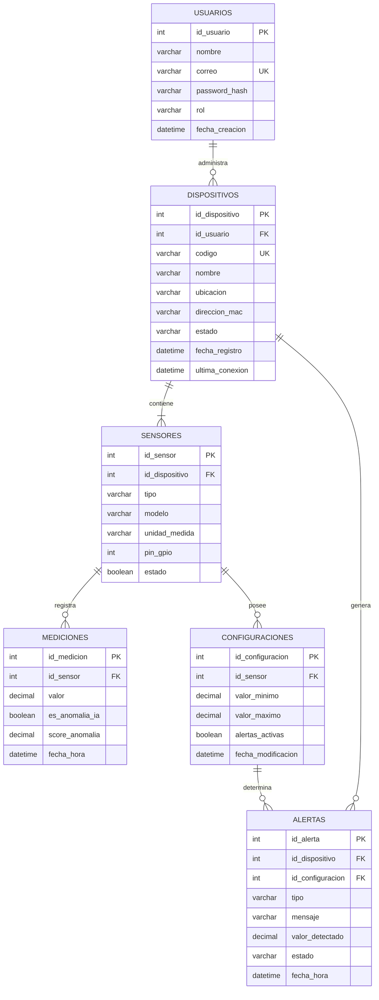

### 5.2 Diccionario de Datos Breve

| Tabla | Atributo Principal | Tipo | Restricción | Descripción |
| :--- | :--- | :--- | :--- | :--- |
| `usuarios` | `id_usuario` | INT | PK, AutoIncrement | Identificador primario de usuario. |
| `usuarios` | `correo` | VARCHAR(120) | UNIQUE, NOT NULL | Cuenta de correo para autenticación. |
| `dispositivos` | `codigo` | VARCHAR(50) | UNIQUE, NOT NULL | Código único del nodo IoT (ej. `ESP32-LAB01`). |
| `dispositivos` | `estado` | VARCHAR(20) | DEFAULT 'Activo' | `Activo`, `Inactivo`, `Mantenimiento`. |
| `sensores` | `tipo` | VARCHAR(30) | NOT NULL | Variable: `Temperatura`, `Humedad`. |
| `configuraciones` | `valor_minimo` | DECIMAL(5,2) | NOT NULL | Límite inferior permitido. |
| `configuraciones` | `valor_maximo` | DECIMAL(5,2) | NOT NULL | Límite superior permitido. |
| `mediciones` | `valor` | DECIMAL(5,2) | NOT NULL | Magnitud registrada (°C o %HR). |
| `mediciones` | `es_anomalia_ia` | BOOLEAN | DEFAULT FALSE | Clasificación generada por Isolation Forest. |
| `alertas` | `estado` | VARCHAR(20) | DEFAULT 'Activa' | `Activa`, `Revisada`, `Resuelta`. |

---

## 6. DISEÑO DE SERVICIOS Y API REST

La API REST sigue la convención estándar OpenAPI 3.0 implementada en FastAPI con rutas estructuradas bajo el prefijo `/api`:

| Método | Endpoint | Parámetros / Body | Descripción |
| :--- | :--- | :--- | :--- |
| `POST` | `/api/auth/login` | `{correo, password}` | Inicio de sesión, retorna Token Bearer JWT. |
| `GET` | `/api/dispositivos` | Header: `Authorization` | Lista de todos los dispositivos registrados. |
| `POST` | `/api/dispositivos` | `{codigo, nombre, ubicacion}` | Registro de un nuevo nodo ESP32 (Solo Admin). |
| `GET` | `/api/dispositivos/{id}` | Path: `id` | Detalle, sensores asociados y estado de conexión. |
| `PUT` | `/api/dispositivos/{id}` | `{nombre, ubicacion, estado}` | Actualización de parámetros de un dispositivo. |
| `GET` | `/api/sensores` | Query: `?dispositivo_id=1` | Catálogo de sensores activos por dispositivo. |
| `POST` | `/api/sensores` | `{id_dispositivo, tipo, modelo}` | Vinculación de un nuevo sensor. |
| `GET` | `/api/mediciones/actuales` | - | Últimas mediciones registradas por dispositivo. |
| `GET` | `/api/mediciones/historico`| Query: `?desde=...&hasta=...` | Lecturas históricas con filtros de tiempo. |
| `GET` | `/api/alertas` | Query: `?estado=Activa` | Listado de alertas pendientes y resueltas. |
| `POST` | `/api/configuraciones` | `{id_sensor, min, max}` | Definición o ajuste de rangos y umbrales. |
| `GET` | `/api/ia/anomalias` | Query: `?limite=50` | Lista de mediciones catalogadas como anómalas. |
| `GET` | `/api/reportes/exportar` | Query: `?formato=csv&desde=...`| Descarga directa de archivo CSV para auditoría. |

---

## 7. DISEÑO DE INTERFACES (UI/UX)

El sistema comprende las siguientes pantallas principales:
1. **Inicio de Sesión (Login):** Formulario minimalista con validación asíncrona, mensajes de error flotantes y gestión de sesión segura.
2. **Dashboard Principal de Monitoreo:**
   - **Tarjetas de Resumen (KPIs):** Temperatura promedio actual, Humedad relativa promedio, Nodos en línea / fuera de línea, Alertas activas.
   - **Selector de Dispositivo:** Menú desplegable para aislar la visualización por aula o laboratorio.
   - **Gráfica de Tendencia Temporal:** Gráfica interactiva de dos ejes (Temperatura en rojo/naranja, Humedad en azul) construida con Chart.js.
   - **Línea de Tiempo de Alertas:** Panel lateral con las últimas 5 alertas generadas en tiempo real.
3. **Módulo de Gestión de Dispositivos:** Tabla CRUD interactiva con búsqueda por texto y modal de creación/edición.
4. **Módulo de Configuración de Umbrales:** Control deslizante (Sliders) o inputs numéricos con vista previa del rango térmico admisible.
5. **Módulo de Análisis Inteligente de Anomalías:** Visualización de puntos dispersos (Scatter plot) donde se marcan en color ámbar/púrpura las lecturas señaladas por la Inteligencia Artificial.
6. **Módulo de Reportes:** Generador con calendario interactivo para exportar archivos `.csv`.


